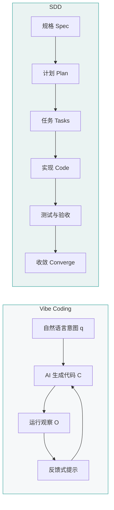
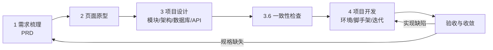

# Vibe Coding 与 SDD

[toc]

## 术语边界

### Vibe Coding

Vibe Coding（氛围编程）是一种 AI 辅助编程方式：开发者用自然语言描述意图，AI 代理生成代码，开发者通过运行结果和后续反馈推动修改。

### SDD

AI 编程语境中的 SDD 是 **Spec-Driven Development，规格驱动开发**：以明确、可验证、可版本管理的规格作为事实源，再推导计划、任务、代码、测试和验收结论。

SDD 在其他语境中也可能表示 Schema-Driven Development（模式驱动开发）或 Software Design Description（软件设计描述）。本笔记中的 SDD 限定为 Spec-Driven Development。

## 过程模型



图 1 的不变量为：Vibe Coding 以对话和运行反馈形成闭环；SDD 以规格、任务和验收条件之间的一致性形成闭环。

## Vibe Coding 的形式化模型

设第 $i$ 轮自然语言提示为 $q_i$，会话历史为 $H_i$，AI 生成代码为 $C_i$，运行观察为 $O_i$。迭代关系为：

$$
C_i=f(q_i,H_i)
$$

$$
O_i=\operatorname{run}(C_i)
$$

$$
q_{i+1}=g(q_i,O_i)
$$

该模型的控制输入是自然语言提示和运行结果；开发者未必逐行审查生成代码。

### 适用条件

Vibe Coding 适用于：

- 原型验证；
- 小型工具；
- 一次性脚本；
- 演示系统；
- 需求尚未稳定的探索阶段。

### 风险集合

| 风险 | 形成条件 |
| --- | --- |
| 隐藏缺陷 | 代码可运行，但边界条件未覆盖 |
| 安全问题 | 输入处理、权限、依赖和外部调用未审查 |
| 架构漂移 | 多轮局部修改缺少统一约束 |
| 维护困难 | 开发者未建立代码结构模型 |
| 需求偏差 | 自然语言提示存在歧义 |

## SDD 的形式化模型

设规格集合为 $S$，计划为 $P$，任务集合为 $T$，代码为 $C$，验收条件集合为 $A$。SDD 的推导关系为：

$$
S=\operatorname{source\ of\ truth}
$$

$$
P=\operatorname{plan}(S)
$$

$$
T=\operatorname{decompose}(P)
$$

$$
C=\operatorname{implement}(T)
$$

代码满足规格的条件为：

$$
\forall a\in A,\quad C\models a
$$

### 典型阶段

GitHub Spec Kit 的标准流程为：

```text
Specify → Plan → Tasks → Implement → Converge
```

| 阶段 | 主要产物 |
| --- | --- |
| Specify | 需求、边界、用户场景和约束 |
| Plan | 技术方案、模块划分和风险 |
| Tasks | 可执行的原子任务 |
| Implement | 代码与测试 |
| Converge | 规格、实现、测试和文档的一致性收敛 |

## 对比表

| 维度 | Vibe Coding | SDD |
| --- | --- | --- |
| 事实源 | 当前提示和运行反馈 | 明确规格 |
| 主要驱动 | 自然语言对话 | 规格、计划和验收条件 |
| 代码审查 | 可依赖运行结果，审查强度较弱 | 对照规格和测试验证 |
| 变更控制 | 会话驱动 | 规格与任务驱动 |
| 可追溯性 | 较弱 | 较强 |
| 前期成本 | 较低 | 较高 |
| 适用阶段 | 探索、原型、小型项目 | 复杂项目、团队协作、长期维护 |
| 主要风险 | 结果不可控、结构漂移 | 规格编写和维护成本较高 |

## 选择条件

设项目复杂度为 $K$，维护周期为 $L$，协作者数量为 $n$，需求稳定度为 $s$。

### 选择 Vibe Coding 的条件

$$
K\ \text{较低}\ \land\ L\ \text{较短}\ \land\ n=1\ \land\ s\ \text{较低}
$$

### 选择 SDD 的条件

$$
K\ \text{较高}\ \lor\ L\ \text{较长}\ \lor\ n>1\ \lor\ s\ \text{较高}
$$

## 组合工作流

两种方法可以按阶段组合：

1. 需求未稳定时，使用 Vibe Coding 快速生成可运行原型；
2. 从运行结果中提取稳定需求、约束和失败案例；
3. 将稳定意图整理为规格集合 $S$；
4. 进入 SDD，形成计划、任务、测试和验收；
5. 后续变更先修改规格，再修改实现。

该组合满足：

$$
\text{探索阶段}\rightarrow \text{规格化}\rightarrow \text{可控交付}
$$

## 落地流程

从想法到可交付系统按阶段推进。每个阶段有产物和门禁，规格变更先回到阶段 1。



**图 2：从需求到验收的落地流程**

图 2 的不变量：每个阶段只消费上一阶段的稳定产物；一致性检查是进入编码前的门禁；需求变更先改规格，再沿箭头向下传导。

### 阶段产物与门禁

| 阶段 | 输入 | 产物 | 进入下一阶段的条件 |
| --- | --- | --- | --- |
| 1 需求梳理 | 业务想法、约束 | PRD、用户故事、验收条件 | 范围与非目标明确，验收条件可判定 |
| 2 页面原型 | PRD | 页面与组件清单、HTML 原型 | 每个页面操作能对应 `US-xx` |
| 3 项目设计 | PRD、原型 | 模块表、ADR、架构图、ER 图与 DDL、OpenAPI | 一致性检查无阻断问题 |
| 4 项目开发 | 设计产物 | 可运行工程、测试、部署脚本 | 原子任务验收条件全部通过 |
| 5 验收收敛 | 全部产物 | 验收报告、差异清单 | 规格、实现、测试一致 |

### 提示词骨架

各阶段共用同一结构，把任务写成可检查的约束：

```text
角色：<例如 资深后端架构师>
目标：<本阶段要产出的单一结果>
上下文：<相关文件路径、需求编号、技术栈、约束>
任务：<按顺序列出 3–6 个动作>
约束：<不新增需求 / 不引入未指定依赖 / 标注不确定项>
输出：<文件路径、格式、字段>
验收：<可执行或可逐条检查的条件>
```

三条通用规则：

1. 一次只推进一个阶段，上一阶段产物确认后再进入下一阶段。
2. 提示词引用文件路径和需求编号，要求模型列出不确定项。
3. 模型补写业务规则时，把内容移入“开放问题”，由人确认后再写入规格。

### 1. 需求梳理：AI 探索并产出 PRD

步骤：

1. 场景访谈：让 AI 逐题提问，一次一问，覆盖角色、目标、触发条件、主流程和异常流程。
2. 划定边界：明确非目标、外部依赖、合规与性能约束。
3. 形成用户故事：`作为<角色>，我要<行为>，以便<价值>`，编号从 `US-01` 起。
4. 编写验收条件：使用 Given/When/Then，编号从 `AC-01` 起，每条可判定。
5. 汇总 PRD：结构化输出，未确认内容保留在开放问题。

PRD 最小结构：

| 章节 | 内容 |
| --- | --- |
| 背景与目标 | 问题、目标用户、成功指标 |
| 范围 | 本期做什么、不做什么 |
| 角色与权限 | 角色、可见数据、可执行操作 |
| 功能清单 | 功能编号、优先级、对应需求 |
| 用户故事 | `US-xx`、主流程、异常流程 |
| 业务规则 | 状态机、校验规则、计算规则 |
| 非功能需求 | 性能、可用性、安全、合规 |
| 验收条件 | `AC-xx`、Given/When/Then |
| 开放问题 | 待确认项、负责人、截止时间 |

提示词：

```text
角色：资深产品经理
目标：把下面的想法整理成可评审的 PRD 初稿
上下文：<业务想法>；<目标用户>；<已知约束>；<现有系统>
任务：
1. 先用一次一个问题的方式向我提问，补齐角色、目标、主流程、异常流程和边界，最多 10 个问题；
2. 我回答后，输出 PRD，章节为：背景与目标、范围（含非目标）、角色与权限、功能清单、用户故事、业务规则、非功能需求、验收条件、开放问题；
3. 用户故事编号从 US-01 起，验收条件编号从 AC-01 起并使用 Given/When/Then；
4. 无法确认的内容写入“开放问题”，不要自行假设。
约束：不引入我未提到的功能和外部依赖。
输出：Markdown，保存到 docs/PRD.md。
验收：每条功能至少对应一条验收条件；非目标章节非空。
```

### 2. 页面原型：AI 设计与调整

步骤：

1. 信息架构：从 PRD 提取页面清单、页面入口、页面出口和跳转关系。
2. 低保真：先输出文字线框或单文件 HTML，确认布局与流程。
3. 高保真：确定配色、字体、间距和组件规范后，再生成完整样式。
4. 状态覆盖：默认、空态、加载、错误、无权限、超长文本。
5. 回写需求：页面和组件标注对应的 `US-xx`。

低保真提示词：

```text
角色：产品设计师
目标：为 PRD 中的 <页面名> 生成可点击的低保真原型
上下文：docs/PRD.md 中 US-xx 与 AC-xx；目标设备 <桌面/移动>
任务：
1. 列出该页面的信息区块、操作入口和跳转关系；
2. 输出单个 HTML 文件，使用 Tailwind CDN，不使用图片素材；
3. 覆盖默认、空态、加载、错误四种状态；
4. 页面顶部标注对应 US 编号，区块旁标注组件名。
约束：只实现 PRD 已有功能；不调用后端，数据使用内联示例。
输出：docs/prototype/<页面名>.html。
验收：浏览器直接打开可用；每个交互入口有可达目标或明确占位。
```

原型调整提示词：

```text
基于 docs/prototype/<页面名>.html，按以下修改项调整：<逐条列出>。
保持现有信息架构与 US 编号标注，只修改指定区域。
输出完整文件，并列出修改点和未处理项。
```

### 3. 项目设计

#### 3.1 准备工作

设计前固定输入，避免边设计边改需求：

| 输入 | 检查点 |
| --- | --- |
| PRD | 版本号、范围、验收条件完整 |
| 原型 | 页面清单、组件清单、状态清单 |
| 约束 | 部署环境、预算、团队技能、合规要求 |
| 非功能 | 用户量、数据量、延迟、可用性 |
| 现有系统 | 对接接口、数据迁移范围 |

建立 `docs/adr/` 保存架构决策记录，每条决策一个文件，格式为背景、候选方案、决策、后果。目录结构：

```text
docs/
  PRD.md
  prototype/
  design/
    modules.md
    architecture.md
    database.md
    schema.sql
    openapi.yaml
    consistency-report.md
  adr/
  runbook.md
```

#### 3.2 功能模块设计

模块按职责和数据归属划分。一个模块满足：职责单一、输入输出明确、数据所有权唯一。

| 字段 | 含义 |
| --- | --- |
| 模块编号 | `M-01` 起 |
| 职责 | 一句话说明 |
| 输入/输出 | 数据或事件 |
| 依赖 | 其他模块或外部系统 |
| 数据所有权 | 拥有的实体 |
| 对应需求 | `US-xx` |

提示词：

```text
角色：系统架构师
目标：把 PRD 拆成可独立开发和测试的功能模块
上下文：docs/PRD.md；docs/prototype/；技术栈 <...>
任务：
1. 按职责与数据所有权划分模块，编号从 M-01 起；
2. 为每个模块输出职责、输入、输出、依赖、拥有的实体、对应 US 编号；
3. 输出模块依赖图（Mermaid flowchart）；
4. 列出跨模块调用和可能形成循环依赖的位置。
约束：不新增 PRD 之外的功能；每个模块至少对应一个 US。
输出：docs/design/modules.md。
验收：不存在无归属的需求；依赖图无环或已标注处理方案。
```

#### 3.3 技术选型与整体架构

选型按可验证的维度比较，每个决策写入 ADR：

| 维度 | 判断依据 |
| --- | --- |
| 团队熟悉度 | 是否有人能维护 |
| 生态与社区 | 版本活跃度、文档、问题响应 |
| 运维成本 | 部署、监控、升级复杂度 |
| 性能与容量 | 是否满足非功能需求 |
| 许可证 | 商用限制 |
| 退出成本 | 替换代价 |

架构产物包括组件图、部署图和关键时序图。跨信任边界时标注认证方式和数据流向。

提示词：

```text
角色：技术负责人
目标：为 <项目> 输出技术选型与整体架构方案
上下文：docs/design/modules.md；非功能需求 <...>；部署环境 <...>；团队技能 <...>
任务：
1. 列出需要决策的技术点：语言、框架、数据库、缓存、消息、部署方式；
2. 每个决策点给出 2–3 个候选、比较维度、结论、理由和风险；
3. 输出组件图与部署图（Mermaid）；
4. 为每个决策生成一份 ADR 摘要。
约束：优先选择团队可维护的方案；不引入无维护的依赖。
输出：docs/design/architecture.md 与 docs/adr/ADR-xx.md。
验收：每个决策有理由和风险；架构图覆盖所有模块与外部系统。
```

#### 3.4 数据库设计

步骤：

1. 从模块表提取实体和关系，画 ER 图。
2. 定义主键、唯一约束、外键、索引和删除策略。
3. 输出数据字典：字段、类型、可空、默认值、含义。
4. 用迁移工具管理 DDL，生产库不手工修改。
5. 检查实体归属与模块表一致。

提示词：

```text
角色：数据库设计师
目标：为 <项目> 输出数据库设计
上下文：docs/design/modules.md；业务规则见 docs/PRD.md
任务：
1. 列出实体、属性、关系，输出 Mermaid ER 图；
2. 输出每张表的 DDL，包含主键、外键、唯一约束、索引和注释；
3. 输出数据字典表：字段、类型、可空、默认值、含义；
4. 标注每张表的数据所有者模块；
5. 列出可能的性能瓶颈和索引依据。
约束：命名统一使用 <snake_case>；不使用保留字；不新增模块表之外的实体。
输出：docs/design/schema.sql 与 docs/design/database.md。
验收：每个实体有唯一所有者；外键与索引对应查询场景。
```

#### 3.5 API 接口设计

采用契约优先：先写 OpenAPI，再实现。统一错误结构、认证方式、分页、幂等和版本策略。

提示词：

```text
角色：后端接口设计师
目标：为 <模块 M-xx> 输出 OpenAPI 3.1 契约
上下文：docs/design/modules.md；docs/design/database.md；认证方式 <...>
任务：
1. 按资源列出路径、方法、请求参数、请求体、响应和状态码；
2. 统一错误响应结构，包含 code、message、details；
3. 标注认证要求、权限、分页和幂等键；
4. 为每个接口给出一个请求示例和一个响应示例；
5. 标注对应的 US 编号。
约束：接口只暴露模块职责内的数据；不设计没有调用方的接口。
输出：docs/design/openapi.yaml。
验收：OpenAPI 通过 lint；每个接口能追溯到 US 和模块。
```

#### 3.6 一致性检查

进入编码前，用矩阵检查五类关系是否闭合：

| 检查 | 通过条件 |
| --- | --- |
| 需求 → 模块 | 每个 `US-xx` 至少属于一个模块 |
| 模块 → 接口 | 每个模块的对外能力都有接口，或明确为内部模块 |
| 接口 → 数据 | 每个接口读写的数据都有实体和字段 |
| 需求 → 验收 | 每条 `AC-xx` 有对应测试计划 |
| 原型 → 接口 | 每个页面操作有对应接口，或明确为本地行为 |

提示词：

```text
角色：技术评审员
目标：检查需求、模块、数据库、API 与原型之间的一致性
上下文：docs/PRD.md、docs/design/modules.md、docs/design/database.md、docs/design/openapi.yaml、docs/prototype/
任务：
1. 建立 US、模块、接口、实体、AC 的对应矩阵；
2. 找出孤立项：无模块的需求、无接口的模块、无实体的字段、无验收条件的 AC、无接口的页面操作；
3. 按严重级别输出问题：阻断、重要、建议；
4. 每个问题给出证据（文件与行号）和修改建议。
约束：只报告能从文件推出的问题；不补充新需求。
输出：docs/design/consistency-report.md。
验收：五类孤立项均有结论；阻断问题为零才进入开发。
```

### 4. 项目开发

#### 4.1 开发工具准备

| 类别 | 内容 |
| --- | --- |
| 编辑器 | VS Code / JetBrains，统一格式化与 lint 插件 |
| AI 工具 | Claude Code / OpenCode / Cursor，限定工作目录与权限 |
| 版本控制 | Git，分支模型与提交模板 |
| 质量工具 | linter、formatter、pre-commit |
| 接口与数据库 | OpenAPI 客户端、数据库客户端 |

版本号写入仓库（`.tool-versions`、`package.json`、`requirements.txt`），保证环境可复现。

#### 4.2 软件环境准备（Docker）

产物为 `Dockerfile`、`compose.yaml`、`.env.example` 和健康检查。数据库、缓存、消息队列使用容器，数据目录挂载卷。

提示词：

```text
角色：DevOps 工程师
目标：为 <项目> 生成本地开发环境
上下文：技术栈 <...>；依赖服务 <数据库/缓存/MQ>；端口约定 <...>
任务：
1. 生成 Dockerfile，使用多阶段构建并以非 root 用户运行；
2. 生成 compose.yaml，包含应用与依赖服务；
3. 为每个服务配置 healthcheck、数据卷和环境变量；
4. 生成 .env.example，不写入真实凭据；
5. 给出启动、停止和清理命令。
约束：镜像版本固定；敏感信息只从环境变量读取。
输出：Dockerfile、compose.yaml、.env.example、docs/dev-env.md。
验收：docker compose up -d 后所有服务 healthy；重启后数据不丢失。
```

#### 4.3 软件环境准备（一键部署）

一键部署的判定条件：在干净机器上执行一条命令得到可运行环境，过程幂等、无手工步骤、失败可重试。

| 目标 | 实现 |
| --- | --- |
| 统一入口 | `Makefile`、`justfile` 或 `task` |
| 环境检查 | 检查 Docker、端口、磁盘 |
| 初始化 | 建库、迁移、种子数据 |
| 常用操作 | `up`、`down`、`logs`、`reset` |
| 验证 | 健康检查与冒烟测试 |

提示词：

```text
角色：DevOps 工程师
目标：把本地环境封装成一键脚本
上下文：compose.yaml、docs/dev-env.md、迁移工具 <...>
任务：
1. 生成 Makefile，包含 up、down、logs、migrate、seed、test、reset 目标；
2. 每个目标执行前检查依赖命令和端口占用；
3. 迁移与种子数据可重复执行，不产生重复数据；
4. 编写 docs/runbook.md，说明首次启动、日常启动和故障恢复。
约束：不把密码写入仓库；reset 需要二次确认。
输出：Makefile、docs/runbook.md。
验收：干净环境执行 make up 可启动；重复执行结果一致。
```

#### 4.4 工程搭建

脚手架包含：目录分层、配置加载、日志、统一错误处理、数据库迁移、测试骨架和健康检查接口。

提示词：

```text
角色：<技术栈> 工程师
目标：为 <项目> 搭建可运行的最小工程骨架
上下文：docs/design/ 下的设计产物；目录约定 <...>；包管理器 <...>
任务：
1. 生成目录结构与分层，说明每层职责；
2. 接入配置、日志、统一错误处理和健康检查；
3. 接入数据库迁移工具并生成首个空迁移；
4. 生成一个示例模块，包含 controller/service/repository 与单元测试；
5. 运行 lint 与测试，贴出结果。
约束：只实现示例模块；不引入设计之外的依赖。
输出：完整工程与 docs/engineering.md。
验收：lint 与测试通过；健康检查返回成功；应用可启动。
```

#### 4.5 迭代开发

1. 从任务列表取一个原子任务，写明输入、输出和验收条件。
2. 先让 AI 输出改动计划，再修改代码。
3. 每个任务配套测试，运行 lint 与测试。
4. 通过后提交，提交信息关联任务编号。
5. 失败时回到规格或设计，不在代码层临时绕过。

提示词：

```text
角色：<技术栈> 工程师
目标：完成原子任务 <T-xx>
上下文：docs/design/ 下的设计产物；相关文件 <路径>；既有约定 <...>
任务：
1. 阅读相关文件，复述任务边界和受影响文件，列出不确定项；
2. 输出改动计划，包含文件、函数和测试；
3. 实现代码与测试；
4. 运行 <lint 命令> 和 <测试命令>，贴出结果；
5. 总结改动和未覆盖项。
约束：只改任务范围内的文件；不新增依赖；修改公共接口时先在计划中说明。
输出：代码、测试、变更摘要。
验收：lint 与测试通过；验收条件逐条对应。
```

## 常见失败模式

| 现象 | 原因 | 处理 |
| --- | --- | --- |
| AI 补写未确认的需求 | 提示词缺少非目标和开放问题约束 | 提示词中禁止假设，未确认内容进入开放问题 |
| 模块越拆越细 | 缺少数据所有权约束 | 以实体归属划分模块，合并无独立数据的模块 |
| 接口与页面不匹配 | 未做原型到接口的对照 | 一致性检查加入“页面操作 → 接口”矩阵 |
| 环境只能在一台机器运行 | 版本未固定、手工步骤未脚本化 | 固定镜像与依赖版本，补充一键脚本 |
| 代码通过但验收失败 | 验收条件不可判定 | 把 AC 改写为 Given/When/Then，并要求证据 |

## 验证

1. 对 Vibe Coding 产物执行运行测试和边界条件测试；
2. 对 SDD 产物检查规格、任务、测试和代码之间的双向追溯；
3. 对同一需求检查是否满足 $\forall a\in A,C\models a$；
4. 若需求变更，先确认规格是否已更新，再检查实现。

## 自测

- Q：需求尚未稳定，但需要快速验证交互流程，应选择哪种方法？
  A：选择 Vibe Coding，以较低成本生成可运行原型。
- Q：长期维护的多模块系统为什么适合 SDD？
  A：SDD 提供规格事实源、任务分解和验收条件，可提高变更的可追溯性。
- Q：代码已经通过运行测试，为什么仍需要规格和边界条件审查？
  A：运行测试只能覆盖已执行路径；规格和边界条件用于约束未测试输入、异常路径和长期变更。

## 参考资料

- [Vibe Coding: Practice, Performance, Productivity, and Risk](https://arxiv.org/pdf/2608.20446)（访问日期：2026-11-02）
- [Replit: What Is Vibe Coding](https://replit.com/blog/what-is-vibe-coding)（访问日期：2026-11-02）
- [Spec-Driven Development: From Code to Contract](https://arxiv.org/pdf/2602.00180)（访问日期：2026-11-02）
- [Spec-Driven Development](https://specdriven.ai/)（访问日期：2026-11-02）
- [GitHub Spec Kit Documentation](https://github.github.com/spec-kit/index.html)（访问日期：2026-11-02）
