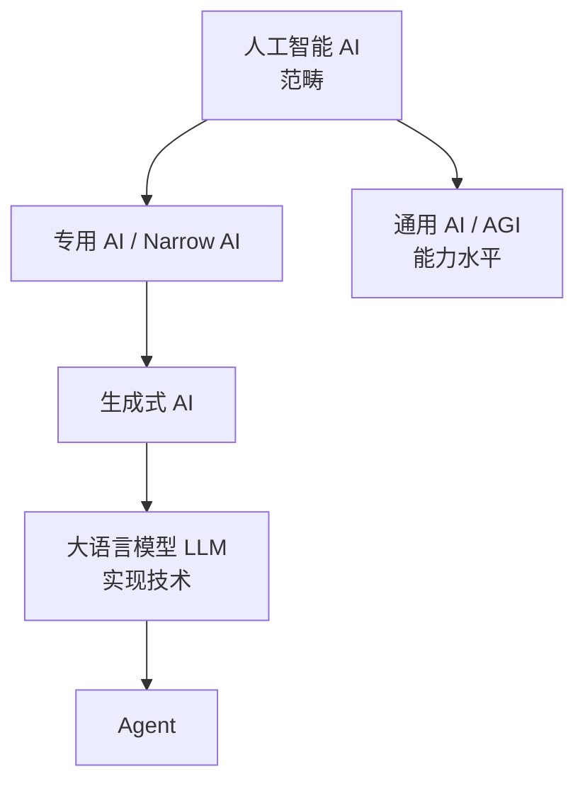

# AI、AGI与LLM

> 费曼版一句话：AI 是"让机器表现出智能"的统称，AGI 指达到人类通用水平的 AI，LLM 是当下实现 AI 的一类具体模型。

## 定义

三个术语不在同一维度，混用是绝大多数误解的来源。先各给一个可操作的界定。

**人工智能（Artificial Intelligence, AI）**：使机器完成通常需要人类智能的任务的技术总称。"需要人类智能"由任务界定，因此该术语的边界随时代移动：算术、下棋曾归入 AI，实现之后便不再被视为智能。

**专用人工智能（Narrow AI）**：在限定任务或任务域内达到人类水平的 AI。当前全部商用系统（含 LLM）属于此类。

**通用人工智能（Artificial General Intelligence, AGI）**：在任意认知任务上达到或超过人类水平、且能跨域迁移的 AI。该术语描述能力水平，尚无公认的形式化定义与判定标准。

**大语言模型（Large Language Model, LLM）**：在大量文本上训练、以自回归方式建模 token 序列条件概率的神经网络

$$
p_\theta(x_t \mid x_1, \dots, x_{t-1})
$$

参数 $\theta$ 规模通常达 $10^9 \sim 10^{12}$。该术语描述实现技术。

三者的关系可概括为：AI 是范畴，AGI 是该范畴内一种能力水平的描述，LLM 是当前逼近该水平的主要技术手段。

## 原理

**智能的操作化定义。** 智能无法直接观测，只能由行为判定。图灵测试给出第一个可操作标准：若对话中人类无法区分对方是机器还是人，则判定其具有智能。该标准的优点是可执行，缺点是只覆盖语言行为。

**LLM 的工作机制。** 模型唯一的目标函数是最大化训练语料的似然，等价于最小化下一 token 的预测损失。训练分两阶段：

1. 预训练：在大规模文本上学习 $p_\theta(x_t \mid x_{<t})$，把语言与世界的统计结构压缩进参数。
2. 对齐：用指令数据与人类反馈调整模型，使输出符合指令与偏好。

**压缩产生智能表象的原因。** 预测下一个 token 要求模型隐式掌握语法、事实与推理模式；损失越低，说明对数据生成过程的建模越准。据此，语言建模可视为对世界的压缩，压缩率越高，对世界结构的把握越深。

**固有边界。**

- 模型输出是条件概率分布的采样，无真值校验机制，故产生幻觉（hallucination）：流畅但事实错误的内容。
- 参数在训练后冻结，无法在线学习，知识截止于训练数据。
- 单次推理受上下文窗口限制，超出部分不可见。

## 心理表征（画出来）

层级关系：AI 为根；专用与通用是两种能力水平分支；生成式 AI 是专用 AI 的子类；LLM 是生成式 AI 的当前主流实例；Agent 建立在 LLM 之上。

## 要点

- 术语维度不同：AI 为范畴，AGI 为能力水平，LLM 为技术实现，三者不可并列比较。
- 当前 LLM 的通用性持续增强，但仍归入专用 AI：其"通用"限于语言与可文本化的任务。
- 判定 AGI 缺少公认标准，"某模型是否达到 AGI"在当下无法严格回答。
- LLM 的能力随参数量、数据量与上下文窗口增大而提升（经验规律），边际收益递减。

## 边界与反例

- 误解一：LLM = AGI。反例：LLM 无持续学习能力，无工具时无法执行动作或访问实时信息，跨域可靠性不足。
- 误解二：AGI 已有统一定义。事实：AGI 的定义与判定标准在学界与业界均无共识。
- 误解三：AI = 机器学习。事实：机器学习是 AI 的子集；符号推理、搜索等亦属 AI。

## 对比辨析

| 维度 | 专用 AI | AGI |
| --- | --- | --- |
| 定义依据 | 任务域内达到人类水平 | 任意认知任务达到人类水平 |
| 迁移性 | 限定 | 跨域 |
| 当前状态 | 已实现（含 LLM） | 未实现，无判定标准 |
| 判定方式 | 任务指标 | 无公认方法 |

## 思维模型迁移

"范畴 / 水平 / 实现"三层区分可迁移到任何技术讨论：先确定讨论对象属于哪一层，再作比较。例如操作系统（范畴）、实时系统（水平）、Linux（实现）；数据库（范畴）、分布式数据库（水平）、PostgreSQL（实现）。混层比较是技术争论失焦的常见原因。

## 自测

- Q：LLM 与 AGI 是否同一层级的概念？
  A：否。LLM 描述实现技术，AGI 描述能力水平；当前 LLM 属专用 AI。
- Q：LLM 产生幻觉的原因是什么？
  A：其目标为建模条件概率分布并采样，不含真值校验机制。
- Q：图灵测试的局限是什么？
  A：仅覆盖语言行为，无法判定非语言能力；可被模仿而非理解地通过。

## 参考

- Anthropic 官方文档：https://docs.anthropic.com
- Turing, A. M. (1950). Computing Machinery and Intelligence. *Mind*, 59(236), 433–460.
