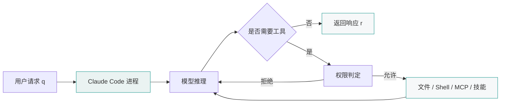

# Claude Code

[toc]

## 定义与边界

Claude Code 是在终端中运行的 AI 编程代理，支持交互式会话、非交互查询、文件读写、命令执行、MCP 工具接入、会话恢复和项目级记忆。

设工作目录为 $W$，用户请求为 $q$，会话历史为 $H$，工具集合为 $T$。一次响应可表示为：

$$
r=f(q,H,W,T)
$$

其中 $T$ 包含文件工具、Shell 工具、MCP 工具、命令与技能等。工具调用的可执行性由权限配置和操作系统权限共同约束。

## 运行模型

图 1 的不变量为：模型输出不直接改变文件系统；文件、命令和外部系统变化通过工具调用产生，并受权限系统约束。

## 常用命令

| 目的 | 命令 |
| --- | --- |
| 启动交互式会话 | `claude` |
| 启动并给出初始任务 | `claude "任务"` |
| 非交互一次性查询 | `claude -p "问题"` |
| 继续当前目录最近会话 | `claude -c` |
| 按会话 ID 恢复 | `claude -r <session-id>` |
| 恢复时创建分叉会话 | `claude --fork-session --resume <session-id>` |
| 管理 MCP 服务 | `claude mcp` |
| 检查安装与配置状态 | `claude doctor` |
| 查看完整帮助 | `claude --help` |

## 会话内命令

在交互式会话中输入 `/` 可列出可用命令。命令用于切换模型、管理权限、清理上下文、执行工作流以及调用技能。MCP 服务暴露的 prompt 也可作为命令出现。

## 项目记忆

Claude Code 的跨会话知识主要通过两类机制承载：

| 机制 | 作用 |
| --- | --- |
| `CLAUDE.md` | 保存项目指令、约束、命令和工作流 |
| `AGENTS.md` | 仓库级 AI 助手指令；Claude Code 可读取 |
| Auto memory | 根据用户纠正和偏好生成的记忆 |

每次会话开始时，上下文窗口不自动包含全部历史会话；持久化指令通过项目记忆文件和配置加载。

## 权限与副作用边界

Claude Code 可影响的对象包括：

- 文件内容；
- 命令执行结果；
- Git 工作区；
- MCP 连接的外部系统；
- 运行中的本地进程。

权限规则只能控制代理可调用的工具范围，不能绕过操作系统自身的文件权限。若进程以普通用户运行，对无写权限的路径仍会返回权限错误。

## 验证

1. 执行 `claude --help`，确认本机命令可用；
2. 执行 `claude doctor`，检查安装、配置和会话状态；
3. 在仓库中检索 `[[Claude Code]]`，确认双链指向本笔记；
4. 运行 `python script/notes_lint.py --all`，确认断链警告消失。

## 自测

- Q：`claude -p` 与 `claude` 的差异是什么？
  A：`claude` 启动交互式会话；`claude -p` 执行一次性查询并退出。
- Q：为什么允许工具调用后仍可能出现文件权限错误？
  A：工具权限控制代理是否能发起操作；操作系统权限控制进程是否能写入目标路径。

## 参考资料

- [Claude Code Overview](https://code.claude.com/docs/en/overview)（访问日期：2026-11-01）
- [Claude Code Quickstart](https://code.claude.com/docs/en/quickstart)（访问日期：2026-11-01）
- [Claude Code CLI Reference](https://code.claude.com/docs/en/cli-reference)（访问日期：2026-11-01）
- [Claude Code Commands](https://code.claude.com/docs/en/commands)（访问日期：2026-11-01）
- [Claude Code Memory](https://code.claude.com/docs/en/memory)（访问日期：2026-11-01）
