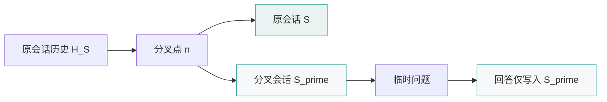

# OpenCode

[toc]

## 定义与边界

OpenCode 是终端内运行的 AI 编程代理，提供 TUI、非交互 `run`、会话管理、代理、MCP 与无头服务等能力。

设当前会话为 $S$，其消息历史为：

$$
H_S=(m_1,m_2,\ldots,m_n)
$$

分叉会话记为 $S'$。在分叉点 $n$，$S'$ 继承 $S$ 的历史；对任意 $k>0$，分叉后的消息满足：

$$
H_{S'}(n)=H_S(n)
$$

$$
m_{n+k}\in H_S \Rightarrow m_{n+k}\notin H_{S'}
$$

$$
m'_{n+k}\in H_{S'} \Rightarrow m'_{n+k}\notin H_S
$$

因此，`--fork` 复制分叉点之前的会话历史，并在分叉后保持两条会话历史相互独立。

## 会话分叉模型



图 1 的不变量为：分叉点之前的上下文可被 $S'$ 读取；分叉点之后，原会话与分叉会话的消息历史互不写入。

## 操作步骤

### 1. 获取原会话 ID

在 OpenCode TUI 中执行：

```text
/sessions
```

默认快捷键：

```text
ctrl+x l
```

也可以在终端执行：

```powershell
opencode session list
```

### 2. 一次性提问并隔离回答

```powershell
opencode run --session "<原会话ID>" --fork "临时问题"
```

`run` 以非交互方式执行问题；`--session` 指定被继承的原会话；`--fork` 在继续前创建分叉会话。

### 3. 创建交互式分叉会话

```powershell
opencode --session "<原会话ID>" --fork
```

该命令进入交互式 TUI，其初始上下文等于原会话在分叉点的历史。

### 4. 返回原会话

在 TUI 中执行：

```text
/sessions
```

选择原会话即可。

## 方案选择

| 条件 | 操作 |
| --- | --- |
| 问题不需要当前上下文 | `/new` 新建会话 |
| 问题需要当前上下文，且回答不能进入原会话 | `--fork` |
| 问题需要当前上下文，并允许回答进入原会话 | 在原会话直接提问 |
| 需要一次性非交互回答 | `opencode run --session <id> --fork "问题"` |

## 隔离边界

`--fork` 的作用域限定为会话历史。以下状态不随会话分叉而复制或隔离：

| 对象 | 分叉后的关系 |
| --- | --- |
| 文件系统 | 多个会话共享同一工作区 |
| Git 工作区 | 分叉会话产生的文件修改可被原会话观察 |
| 数据库 | 写入操作对外部数据库持续生效 |
| 外部 API | 调用产生的外部状态独立于会话存在 |
| 进程状态 | 进程由操作系统管理，不隶属于会话历史 |

若分叉会话仅用于咨询，应在问题中明确约束：只读分析，不修改文件。

## 快捷键状态

OpenCode 的默认快捷键配置中，`session_fork` 为 `none`，即 TUI 默认没有绑定分叉快捷键；CLI 的 `--fork` 参数可直接使用。新建会话的默认快捷键为 `ctrl+x n`，对应 TUI 命令 `/new`。

## 验证

1. 执行 `opencode session list`，确认分叉后存在独立会话；
2. 在分叉会话中发送测试问题；
3. 打开原会话，确认测试问题与回答未进入原历史；
4. 若分叉会话执行过文件操作，使用 `git status` 检查文件系统变化。

## 自测

- Q：为什么分叉会话修改文件后，原会话仍能看到变化？
  A：分叉复制的是消息历史，文件系统由操作系统统一管理；文件修改不随会话历史隔离。
- Q：`--fork` 与 `/new` 的适用条件有何差异？
  A：`--fork` 继承指定会话的历史；`/new` 创建空上下文会话。

## 参考资料

- [OpenCode CLI 文档：--continue、--session、--fork](https://opencode.ai/docs/cli/)（访问日期：2026-11-01）
- [OpenCode TUI 文档：/new、/sessions](https://opencode.ai/docs/tui/)（访问日期：2026-11-01）
- [OpenCode Keybinds 文档：session_fork、session_new](https://opencode.ai/docs/keybinds/)（访问日期：2026-11-01）
