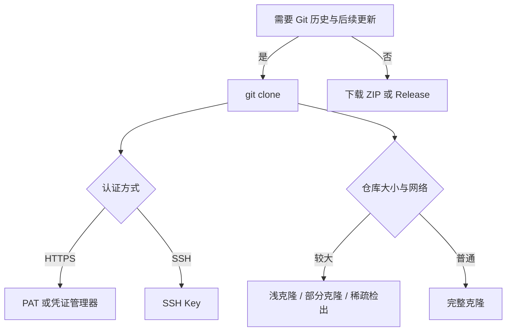

# GitHub 项目获取与常用知识

## 1. 先区分 Git 与 GitHub

Git 是分布式版本控制系统，负责提交、分支、合并和本地仓库。GitHub 是托管 Git 仓库的协作平台，在仓库之外还提供 Issue、Pull Request、Actions、Releases、Codespaces 和权限管理。

从 GitHub“拿一个项目”可以指三件事：

- 取得完整 Git 仓库，保留提交历史，后续可以 `fetch`、`pull`、`push`。
- 取得某个版本的源码快照，不保留 `.git` 目录，只用于阅读或一次性构建。
- 在云端或图形工具中打开项目，不落地到本地命令行环境。

前两类的边界由是否保留 `.git` 决定；第三类由运行环境决定。

## 2. 获取方式总览

| 方式 | 得到什么 | 保留历史 | 后续更新 | 典型场景 |
| --- | --- | --- | --- | --- |
| `git clone` HTTPS | 完整仓库 | 是 | `git pull` | 通用；需要 PAT 或凭证管理器 |
| `git clone` SSH | 完整仓库 | 是 | `git pull` | 经常推送；已配置 SSH Key |
| `gh repo clone` | 完整仓库 | 是 | `git pull` | 已登录 GitHub CLI |
| GitHub Desktop / IDE | 完整仓库 | 是 | 由工具执行 | 图形操作；VS Code、JetBrains |
| Download ZIP | 默认分支快照 | 否 | 重新下载 | 只读、一次性编译 |
| Release 源码包 | 指定版本快照 | 否 | 重新下载 | 固定版本、复现实验 |
| Release 二进制附件 | 编译产物 | 否 | 重新下载 | 直接运行或部署 |
| Fork 后 clone | 自己账号下的副本 | 是 | 可同步 upstream | 提交 PR、长期修改 |
| Use this template | 新仓库 | 是 | 按新仓库管理 | 以项目为模板启动新项目 |
| Codespaces | 云端开发环境 | 是 | 云端保存 | 本机无环境或临时开发 |
| 包管理器 / 容器镜像 | 发布产物 | 通常否 | 包管理器更新 | 作为依赖使用，不读源码 |

图 1 项目获取方式选择



需要提交代码或同步上游时选择 `clone`；只读源码时选择 ZIP 或 Release；准备贡献代码时先 Fork，再克隆自己的副本。

## 3. 本地克隆

### 3.1 HTTPS

```bash
git clone https://github.com/<owner>/<repo>.git
```

HTTPS 适合大多数网络环境。公开仓库可以直接克隆；私有仓库需要个人访问令牌（Personal Access Token，PAT）或已配置的凭证管理器。

GitHub 已停止使用账户密码进行 Git 操作。HTTPS 提示输入密码时，应输入 PAT，不要输入 GitHub 登录密码。

### 3.2 SSH

```bash
git clone git@github.com:<owner>/<repo>.git
```

SSH 使用密钥对认证，适合经常推送的开发者。首次使用需要生成密钥、把公钥添加到 GitHub，并验证连接：

```bash
ssh-keygen -t ed25519 -C "you@example.com"
ssh -T git@github.com
```

`ssh -T` 返回 `successfully authenticated` 表示认证通过。密钥生成、代理和多账号配置见 [[ssh]]。

网络封锁 22 端口时，可以在 `~/.ssh/config` 中让 GitHub 走 443 端口：

```sshconfig
Host github.com
    HostName ssh.github.com
    Port 443
    User git
```

### 3.3 GitHub CLI

安装 GitHub CLI 后，可以按 `owner/repo` 形式克隆，认证由 `gh` 管理：

```bash
gh auth login
gh repo clone <owner>/<repo>
```

`gh repo clone` 最终仍调用 Git。需要传入 Git 参数时，在命令后加 `--`：

```bash
gh repo clone <owner>/<repo> -- --depth 1
```

### 3.4 图形工具与 IDE

- GitHub Desktop：`File → Clone repository`，可以选择 GitHub 账号下的仓库或输入 URL。
- VS Code：命令面板执行 `Git: Clone`，再选择本地目录。
- JetBrains IDE：`Get from VCS`，输入仓库 URL。

图形工具与命令行克隆得到相同的 `.git` 仓库，差别只在认证和操作界面。

## 4. 不建立 Git 仓库的获取方式

### 4.1 Download ZIP

在仓库首页选择 `Code → Download ZIP`，得到默认分支的文件快照。ZIP 内没有 `.git` 目录，不能执行 `git pull`、`git log`，也不能直接推送。

适合阅读源码、一次性构建或把代码交给不熟悉 Git 的环境。需要跟随上游更新时，应改用 `git clone`。

### 4.2 Release 源码包和二进制附件

Release 是仓库的版本发布记录，通常包含：

- `Source code (zip)` 和 `Source code (tar.gz)`：该标签对应的源码快照。
- 维护者上传的二进制、安装包、校验文件。

源码包同样不包含 `.git` 历史。需要固定版本复现时，Release 比默认分支 ZIP 更明确。

```bash
gh release list -R <owner>/<repo>
gh release download <tag> -R <owner>/<repo>
```

### 4.3 Codespaces 与云端 IDE

GitHub Codespaces 在云端启动开发容器，浏览器内提供 VS Code 界面。它适合本机没有编译环境、临时查看项目或需要隔离环境的场景。

Codespaces 仍然基于仓库，但工作区在云端；关闭环境后本地没有对应目录，除非另外克隆或导出。

## 5. Fork、模板与上游同步

### 5.1 Fork

Fork 是在 GitHub 服务器上复制一份仓库到自己的账号，不是本地副本。Fork 后仍需要克隆到本地：

```bash
gh repo fork <owner>/<repo> --clone
```

克隆后通常把原仓库添加为 `upstream`：

```bash
git remote add upstream https://github.com/<owner>/<repo>.git
git remote -v
```

同步上游：

```bash
git fetch upstream
git switch main
git merge upstream/main
```

`origin` 指向自己的 Fork，`upstream` 指向原仓库。提交 Pull Request 时，从自己的分支向原仓库发起合并请求。

### 5.2 Use this template

`Use this template` 会基于模板创建新仓库，新仓库与原项目没有 Fork 关系，也不会自动接收原项目的更新。它适合以项目骨架启动自己的工程。

### 5.3 Import repository

GitHub 的 `Import repository` 用于从其他 Git 托管平台导入仓库，不是把 GitHub 项目取到本地的常用方式。

## 6. 克隆变体

### 6.1 浅克隆

```bash
git clone --depth 1 https://github.com/<owner>/<repo>.git
```

只获取最近一次提交，适合只需要当前源码的场景。需要完整历史时执行：

```bash
git fetch --unshallow
```

更多 `--depth`、`--single-branch`、`--no-tags` 的组合见 [[git克隆精简]]。

### 6.2 部分克隆

```bash
git clone --filter=blob:none https://github.com/<owner>/<repo>.git
```

部分克隆先取提交和目录树，文件内容在需要时再下载。它适合历史很大、但当前只需要部分文件的仓库。GitHub 支持该协议；旧版 Git 可能不支持。

### 6.3 稀疏检出

```bash
git clone --sparse https://github.com/<owner>/<repo>.git
cd <repo>
git sparse-checkout set <目录>
```

稀疏检出限制工作区显示的文件范围，提交历史仍然保留。它常与部分克隆组合，用于大型单体仓库。

### 6.4 子模块

仓库包含 `.gitmodules` 时，子模块是独立仓库，不会随主仓库自动完整检出：

```bash
git clone --recurse-submodules https://github.com/<owner>/<repo>.git
```

已经克隆但子模块目录为空时：

```bash
git submodule update --init --recursive
```

### 6.5 Git LFS

仓库使用 Git LFS 时，大文件在仓库中保存为指针。先安装 LFS，再克隆或拉取：

```bash
git lfs install
git lfs pull
```

没有 LFS 时，工作区中的大文件可能只有几百字节的指针文本。

## 7. 认证方式

### 7.1 HTTPS 与 PAT

PAT 在 GitHub 的 `Settings → Developer settings → Personal access tokens` 中创建。

- Fine-grained token：按仓库授权，私有仓库至少需要 `Contents: Read`；需要推送时给写权限。
- Classic token：私有仓库通常需要 `repo` 范围。

PAT 应交给 Git Credential Manager 或 `gh auth login` 保存。不要写入仓库 URL、脚本或 `.git/config`：

```bash
git remote -v
```

发现 URL 中带令牌时，立即更换远程地址并撤销令牌。

### 7.2 SSH Key

SSH 认证使用公钥/私钥对。公钥上传到 GitHub，私钥留在本机并设置权限。Windows 下可以使用 OpenSSH Agent 管理私钥口令。

验证顺序：

```bash
ssh -T git@github.com
git clone git@github.com:<owner>/<repo>.git
```

### 7.3 组织 SSO

组织启用 SAML SSO 后，PAT 或 SSH Key 需要在组织设置中授权。未授权时，私有仓库可能表现为 `Repository not found` 或 403，而不是明确的权限错误。

## 8. 克隆后的验证

```bash
git remote -v
git status
git branch --show-current
git log -1 --oneline
```

检查点：

- `origin` 的 fetch/push 地址正确。
- 工作区干净，或明确知道已有本地修改。
- 当前分支是预期分支，不是误入的标签或旧分支。
- `git log` 的 HEAD 与预期提交一致。

## 9. 常见错误

| 现象 | 常见原因 | 处理 |
| --- | --- | --- |
| `Repository not found` | 私有仓库未认证、组织 SSO 未授权、URL 拼写错误 | 检查权限与 URL；`gh auth status` |
| `Permission denied (publickey)` | 公钥未添加到 GitHub、私钥未加载、使用了错误账号 | `ssh -T git@github.com`；检查 `ssh-add -l` |
| `Support for password authentication was removed` | 使用账户密码做 HTTPS 认证 | 改用 PAT 或 SSH |
| `RPC failed; HTTP 413` | 仓库或单次传输过大 | 浅克隆、部分克隆；避免只调大 `http.postBuffer` |
| `SSL certificate problem` | 公司代理或自签证书 | 配置受信任 CA；不要直接关闭证书校验 |
| `fatal: early EOF` | 网络中断或大仓库传输失败 | 重试；浅克隆；检查代理 |
| 子模块目录为空 | 未初始化子模块 | `git submodule update --init --recursive` |
| 大文件只有指针文本 | 未安装或未拉取 Git LFS | `git lfs install`、`git lfs pull` |
| 修改后无法 `pull` | 使用 ZIP 获取，或本地有未提交修改 | 改用 clone；提交、暂存或清理本地修改 |

## 10. 安全与许可证

克隆仓库不会执行项目代码。执行 `npm install`、`make`、`pip install -e .`、`docker build` 或项目自带脚本时，才会运行维护者提供的代码。

获取项目后至少检查：

- `README` 的构建步骤和依赖来源。
- `LICENSE` 的授权范围；没有许可证的仓库默认保留版权，不能按开源项目随意复用。
- `package.json` 的 `scripts`、`Makefile`、`install.sh`、`configure` 等入口。
- `.env.example` 与实际密钥的隔离方式。
- Release 是否提供校验和或签名。

需要长期使用某个版本时，固定标签或提交哈希，比跟随默认分支稳定。

## 11. 选择建议

- 只读源码、一次性编译：Download ZIP 或 Release 源码包。
- 需要持续更新、提交代码：`git clone` HTTPS 或 SSH。
- 经常在命令行操作且已登录：`gh repo clone`。
- 准备给上游提交修改：Fork 后克隆，配置 `upstream`。
- 仓库很大或网络不稳定：浅克隆、部分克隆、稀疏检出。
- 本机没有环境：Codespaces。
- 只是把项目作为依赖：优先使用包管理器或容器镜像，不直接克隆源码。
