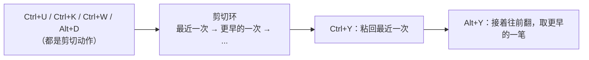

# bash 命令行快捷键

[toc]

> 在 Linux / WSL 终端里敲命令时的行内编辑操作，由 readline 库提供，默认走 Emacs 模式。
> 有一条规则要先记住：**这里的「删除」是剪切**，删掉的内容都进了剪切环，`Ctrl+Y` 能粘回来。所以删错了不用重敲整行。
> 脚本语法（变量、判断、循环）是另一个主题，见 [bash](./bash.md)。

## 一、删除

### 单个字符

- `Backspace` / `Ctrl+H`：删光标左边一个字符
- `Ctrl+D`：删光标所在位置的字符（右边那个）。**空行时按 `Ctrl+D` 是 EOF，直接退出当前 shell**，别在这上面误退

### 单词

- `Ctrl+W`：删光标前面一个单词（按空格切分，最常用）
- `Alt+Backspace`：同上，某些终端里更顺手
- `Alt+D`：删光标后面一个单词

### 大范围

- `Ctrl+U`：删光标到行首，光标在行尾时就是清空整行
- `Ctrl+K`：删光标到行尾

`Ctrl+U` 配 `Ctrl+K` 能快速重组一行：先全清掉，或者只留中间一段，其余用 `Ctrl+Y` 粘回来。

## 二、撤销

- `Ctrl+_`（`Ctrl+Shift+-`）：撤销刚才的行内编辑
- `Ctrl+X Ctrl+U`：同上，备用键位

撤销只针对当前命令行，历史里已经执行过的命令不受影响。

## 三、光标移动

- `Ctrl+A` 行首，`Ctrl+E` 行尾
- `Ctrl+B` 左移一个字符，`Ctrl+F` 右移一个字符
- `Alt+B` 左跳一个单词，`Alt+F` 右跳一个单词
- `Ctrl+X Ctrl+X` 与标记位互换（先用 `Ctrl+A` 或 `Ctrl+E` 定位，再按它就能在两点间来回跳）

移动键和删除键是配套的：`Ctrl+W` 之前先用 `Alt+B` 跳过去，或者 `Ctrl+U` 之前先用 `Ctrl+A` 把光标放对位置，删的范围才准确。

## 四、剪切环

删除动作把内容推进剪切环（kill ring），这是一个可以向前翻的栈：



- `Ctrl+Y`：粘回最近一次剪切的内容
- `Alt+Y`：紧跟 `Ctrl+Y` 之后按，取剪切环里更早的一笔（反复按能一直往前翻）

比如先 `Ctrl+U` 删掉前半行、再 `Ctrl+K` 删掉后半行，两次删除分别在环里；`Ctrl+Y` 得后半段，再 `Alt+Y` 就换成前半段。

## 五、历史、补全与其他

```text
Ctrl+P / Ctrl+N        上一条 / 下一条历史（等同 ↑ ↓）
Ctrl+R                 反向搜索历史，再按 Ctrl+R 继续往前找
                       回车执行，Ctrl+G 或 Ctrl+C 取消这次搜索
Ctrl+L                 清屏（等同 clear，当前输入不丢）
Ctrl+C                 放弃当前输入，另起一行
Ctrl+T                 交换光标处两个字符（打错顺序时好用）
Alt+T                  交换光标前后两个单词
Alt+.                  插入上一条命令的最后一个参数（省去重敲长路径）
Tab                    补全命令、路径、变量名；连按两次列出候选
Ctrl+X Ctrl+E          用 $EDITOR 打开当前命令行，适合改一长串命令
```

`Ctrl+S` 要留意：不少终端把它当流控键，按下后屏幕看着像卡死，按 `Ctrl+Q` 能恢复。想去掉这个行为，在 `~/.bashrc` 里加 `stty -ixon`。

## 六、模式切换与配置

readline 有两套键位风格，默认 Emacs 模式（上面全是这一套）；习惯 vim 的可以切成 vi 模式：

```bash
set -o vi        # 切到 vi 模式：Esc 回普通模式，用 hjkl 移动
set -o emacs     # 切回 Emacs 模式
set -o | grep -E 'emacs|vi'    # 看当前是哪个
```

键位和补全行为也可以写进 `~/.inputrc` 持久化（对所有使用 readline 的程序生效，不限于 bash）：

```text
set editing-mode emacs
set completion-ignore-case on        # 补全忽略大小写
"\C-w": unix-word-rubout             # 重新绑定 Ctrl+W
```

改完 `~/.inputrc` 后开新终端生效，或按 `Ctrl+X Ctrl+R` 重新加载。

两个实测容易卡的点：

- **Alt 组合可能被终端吞掉**。Windows Terminal、部分 SSH 客户端会拦截 `Alt+D`、`Alt+F` 这类组合，表现是按了没反应。终端设置里关掉相关快捷键，或用 `Alt+\` 系列之外的替代键。
- **vi 模式和 vim 不是一回事**。vi 模式下按 `Esc` 进的是 readline 自己的普通模式，行为和 vim 的 Normal 相似但不完全一样，别指望 `<leader>` 那套配置生效。

## 七、小结

1. 这里的删除都是剪切，删错了 `Ctrl+Y` 粘回来，`Alt+Y` 往前翻更早的。
2. 删词用 `Ctrl+W`（前）和 `Alt+D`（后），删一段用 `Ctrl+U`（到行首）和 `Ctrl+K`（到行尾）。
3. 移动是删除的前置动作：`Ctrl+A` / `Ctrl+E` / `Alt+B` / `Alt+F` 先把光标放对。
4. 找历史命令别按 ↑ 一条条翻，`Ctrl+R` 直接搜。

## 自测

- Q：`Ctrl+U` 到底是清空整行还是只删光标之前？
  A：只删光标到行首。光标在行尾时才相当于清空整行；所以习惯上先 `Ctrl+E` 再 `Ctrl+U`，清行更稳妥。
- Q：误删了半行，怎么拿回来？
  A：`Ctrl+Y` 粘回最近一次删掉的内容；想取更早那一笔就紧接着按 `Alt+Y`。
- Q：空行上按 `Ctrl+D` 为什么把终端关了？
  A：`Ctrl+D` 在空行被当作 EOF 输入，交互式 shell 收到就退出。它删字符的作用只在行内有内容时成立。
- Q：`Alt+D` 按了没反应，怎么办？
  A：多半是终端（Windows Terminal、SSH 客户端）把 Alt 组合截走了。到终端设置里解除该快捷键，或改用 `Ctrl+W` 系键位。

## 关联

- [bash](./bash.md)：脚本语法与 `.bashrc` 配置，命令行编辑键位是交互侧的部分。
- [vim](./vim.md)：切成 vi 模式后，键位思路和 vim 的 Normal 模式相近。
- [终端中文乱码](../环境/终端中文乱码.md)：终端本身的显示、编码问题。
