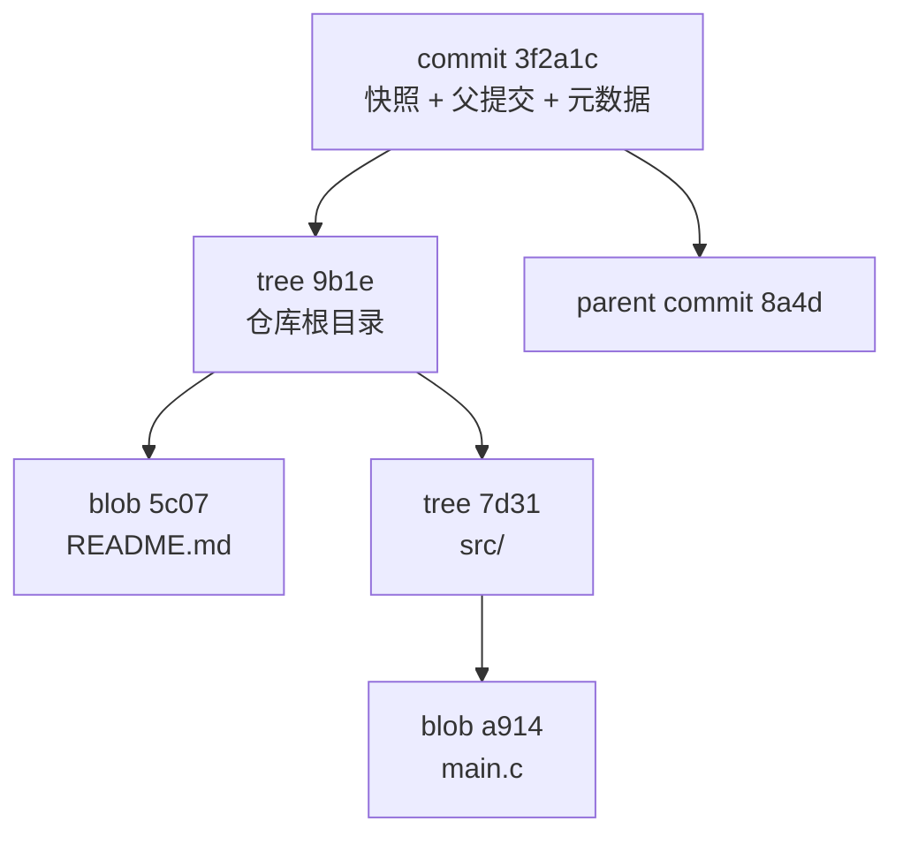
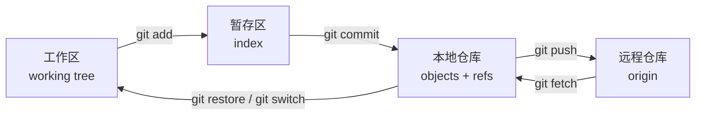
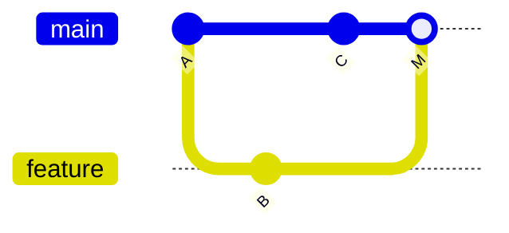

# git

[toc]

> Git 是分布式版本控制系统，用提交快照记录文件集合的变化，支持分支、合并、回退与多人协作。本文覆盖本地仓库的对象模型、配置、日常操作、撤销恢复和远程协作；托管平台侧的克隆变体、PAT、Fork 与 Release 见 [GitHub项目获取与常用知识](./GitHub项目获取与常用知识.md)。
> 命令在 Git 2.49（Windows）验证。`switch`、`restore` 需要 Git 2.23 及以上。

## 一、定位与边界

版本控制系统（Version Control System，VCS）管理文件集合随时间的快照，提供历史查询、版本回退、分支并行开发和变更合并。Git 属于分布式 VCS：每个克隆都带完整提交历史，离线也能提交和查看历史；远程仓库承担交换与备份职责。

适用对象以文本文件为主，源码、配置、Markdown 都在此列。大型二进制文件（视频、模型、编译产物）每次修改都会产生完整新对象，仓库体积增长快，应改用 Git LFS 或放到制品库。

Git 与 GitHub 的边界：Git 是本地工具与协议，GitHub 是托管 Git 仓库的平台，额外提供 Issue、Pull Request、Actions 和权限管理。GitHub 不可用时，本地 Git 操作照常进行。

## 二、核心模型

### 2.1 四类对象

Git 仓库中的内容以对象（object）形式存储，对象按内容的哈希值寻址。四类对象：

| 对象 | 内容 | 对应概念 |
| --- | --- | --- |
| blob | 文件内容，不含文件名 | 文件的一个版本 |
| tree | 目录项列表，每项记录名称、模式和对象哈希 | 目录的一个版本 |
| commit | 指向一棵 tree、零到多个父 commit、作者与提交信息 | 一次快照 |
| tag（附注标签） | 指向一个对象的引用，含标签名、打标签者、说明 | 版本标记 |

commit 的哈希由 tree、父提交、作者、提交者、时间和提交信息共同决定。任一字段变化都会产生新哈希，因此提交一旦生成，内容不可修改；`git commit --amend` 实际创建新提交并移动引用。

图 1 commit、tree 与 blob 的包含关系



commit 之间通过父提交指针构成有向无环图（DAG）。分支只是指向某个 commit 的可移动引用，创建分支不复制文件。

### 2.2 引用

引用（ref）是记录 commit 哈希的文件，位于 `.git/refs/` 或打包后的 `.git/packed-refs`。

| 引用 | 路径 | 含义 |
| --- | --- | --- |
| `HEAD` | `.git/HEAD` | 当前检出位置；通常指向一个分支，也可直接指向 commit |
| 分支 | `refs/heads/<name>` | 本地分支，随提交前移 |
| 远程跟踪分支 | `refs/remotes/<remote>/<name>` | 远程分支在本地的只读镜像，由 `fetch` 更新 |
| 标签 | `refs/tags/<name>` | 固定指向某个对象，默认不移动 |

`HEAD` 直接指向 commit 而不再指向分支时称为分离头指针（detached HEAD）。此时新提交不属于任何分支，切换走后可能被回收；需要保留时先创建分支：

```bash
git switch -c rescue
```

### 2.3 工作区、暂存区与仓库

Git 把一次提交拆成两个显式步骤：先选择要提交的变更，再生成快照。

图 2 三个区域与常用命令



| 区域 | 存放内容 | 查看差异 | 回退方式 |
| --- | --- | --- | --- |
| 工作区 | 当前可编辑的文件 | `git diff` | `git restore <file>` |
| 暂存区 | 下次提交的候选快照 | `git diff --staged` | `git restore --staged <file>` |
| 本地仓库 | 已提交的对象与引用 | `git log` | `git reset` / `git revert` |

从图 2 得到的约束：`commit` 只读取暂存区，未 `add` 的修改不会进入提交；`fetch` 只更新远程跟踪分支，不修改工作区和当前分支。

## 三、配置

### 3.1 配置级别

| 级别 | 参数 | 文件 | 作用范围 |
| --- | --- | --- | --- |
| system | `--system` | Git 安装目录下的 `etc/gitconfig` | 本机所有用户 |
| global | `--global` | 用户主目录下的 `.gitconfig` | 当前用户所有仓库 |
| local | `--local`（默认） | 仓库内 `.git/config` | 当前仓库 |

优先级为 local > global > system，后读取的值覆盖先读取的值。查看实际生效值与来源：

```bash
git config --list --show-origin --show-scope
git config --get user.email
```

### 3.2 首次配置

```bash
git config --global user.name "Your Name"
git config --global user.email "you@example.com"
git config --global init.defaultBranch main
git config --global core.editor "code --wait"
```

`user.name` 与 `user.email` 写入每个 commit 的元数据，不会自动验证身份。使用错误邮箱提交后，需要 `--amend` 或改写历史才能更正。

### 3.3 换行符

Windows 与 Linux 的换行约定不同（CRLF 与 LF）。跨平台仓库统一在版本库中保存 LF：

| 环境 | `core.autocrlf` | 行为 |
| --- | --- | --- |
| Windows | `true` | 检出转 CRLF，提交转 LF |
| Linux / macOS | `input` | 提交转 LF，检出保持 LF |
| 团队仓库 | `false` + `.gitattributes` | 由 `* text=auto` 等规则按文件类型控制 |

```bash
git config --global core.autocrlf true    # Windows
git config --global core.autocrlf input   # Linux / macOS
```

仅设置 `autocrlf` 时，仓库中已有文件的换行不会被追溯修改；团队项目应提交 `.gitattributes` 固定规则。

### 3.4 拉取策略与别名

```bash
git config --global pull.ff only          # 分叉时直接报错，要求手动 merge 或 rebase
git config --global fetch.prune true      # fetch 时清理已删除的远程分支
git config --global alias.lg "log --oneline --graph --decorate --all"
git config --global alias.st "status -sb"
```

`pull.ff only` 禁止隐式合并，分叉时暴露出来，由操作者选择合并方式。需要默认合并时设为 `pull.rebase false`，需要默认变基时设为 `pull.rebase true`。

Windows 下 Git 自带凭证管理器，HTTPS 认证交给系统凭据存储：

```bash
git config --global credential.helper manager
```

`credential.helper store` 把口令明文写入 `~/.git-credentials`，除一次性环境外不使用。

本仓库的提交模板为 `.gitmessage`，启用方式：

```bash
git config commit.template .gitmessage
```

提交信息规范见 [AGENTS.md](../../AGENTS.md) 第 9.3 节。

## 四、日常流程

### 4.1 创建与获取

```bash
git init                     # 在当前目录创建仓库
git init <dir>               # 创建目录并初始化
git clone <url>              # 克隆远程仓库
git clone --depth 1 <url>    # 浅克隆，仅最近一次提交
```

克隆参数的取舍见 [git克隆精简](./git克隆精简.md)。

### 4.2 查看状态与差异

```bash
git status -sb                       # 分支、领先/落后数量、变更文件
git diff                             # 工作区 vs 暂存区
git diff --staged                    # 暂存区 vs 最后一次提交
git diff HEAD                        # 工作区 vs 最后一次提交
git diff <commit1> <commit2> -- <path>   # 两个提交之间指定路径的差异
```

`git status` 的输出分三段：已暂存（staged）、已修改未暂存（modified）、未跟踪（untracked）。未跟踪文件不会出现在 `git diff` 中，需要先 `git add -N <file>` 或直接查看。

### 4.3 暂存与提交

```bash
git add <file>            # 暂存指定文件
git add <dir>             # 暂存目录下所有变更
git add -u                # 只暂存已跟踪文件的修改与删除
git add -p                # 按块选择要暂存的修改
git commit -m "说明"      # 提交暂存区
git commit                # 打开编辑器写多行提交信息
git commit -a -m "说明"   # 跳过 add，提交所有已跟踪文件的修改
```

`git add -p` 用于把一次改动拆成多个语义独立的提交。`git commit -a` 不包含未跟踪文件。

提交信息采用「摘要 + 空行 + 正文」结构：摘要说明做了什么，正文说明动机与影响范围。本仓库要求使用中文，模板见 `.gitmessage`。

### 4.4 查看历史

```bash
git log --oneline --graph --decorate --all
git log -p -- <file>              # 文件的逐次修改
git show <commit>                 # 提交内容与差异
git show <commit>:<path>          # 某提交中某文件的内容
git blame <file>                  # 每行的最后修改提交
git log -S "keyword" -- <file>    # 按内容出现/消失搜索提交
git log --since="2 weeks ago"
```

`git log` 默认只显示当前分支可达的提交；加 `--all` 查看所有分支，加 `--graph` 显示合并结构。

### 4.5 移动与删除文件

```bash
git mv <old> <new>     # 移动并暂存
git rm <file>          # 删除文件并暂存删除
git rm --cached <file> # 停止跟踪，保留工作区文件
```

Git 不存储重命名操作，只记录删除与新增；`git log --follow <file>` 可以跨重命名追踪历史。

## 五、分支与合并

### 5.1 分支操作

```bash
git branch                       # 本地分支
git branch -vv                   # 本地分支与上游、领先/落后数量
git branch -a                    # 含远程跟踪分支
git switch <branch>              # 切换分支
git switch -c <branch>           # 创建并切换
git switch -                     # 回到上一个分支
git branch -m <new>              # 重命名当前分支
git branch -d <branch>           # 删除已合并分支
git branch -D <branch>           # 强制删除未合并分支
```

`git branch -d` 在分支未合并到当前分支时拒绝删除，防止丢失提交；确认要丢弃时用 `-D`。

### 5.2 合并

```bash
git switch main
git merge <branch>               # 能快进则快进，否则三方合并
git merge --no-ff <branch>       # 总是生成合并提交
git merge --abort                # 放弃本次合并
```

| 模式 | 触发条件 | 结果 |
| --- | --- | --- |
| 快进（fast-forward） | 目标分支是当前分支的直接后继 | 当前分支指针前移，不产生合并提交 |
| 三方合并（three-way merge） | 两个分支自共同祖先起都有新提交 | 生成含两个父提交的合并提交 |
| `--no-ff` | 显式指定 | 即使能快进也生成合并提交，保留分支边界 |

图 3 分支与合并提交



合并提交 M 有两个父提交 B 与 C，历史保留分叉结构。快进不产生 M，历史呈一条直线，分支曾存在的事实不可见。

### 5.3 解决冲突

冲突发生在两个分支修改了同一文件的同一区域，或一方修改、一方删除时。`git merge` 会停在冲突状态，并在文件中写入标记：

```text
<<<<<<< HEAD
当前分支的内容
=======
被合并分支的内容
>>>>>>> feature
```

处理步骤：

```bash
git diff --name-only --diff-filter=U   # 列出冲突文件
# 编辑文件，删除标记，保留正确内容
git add <file>                        # 标记为已解决
git commit                            # 完成合并提交
git merge --abort                     # 或放弃合并，恢复合并前状态
```

`git checkout --ours <file>` 与 `--theirs <file>` 直接选择一边，仅适用于确认整文件取某一侧的场景。

### 5.4 变基

```bash
git switch feature
git rebase main
git rebase --continue     # 解决冲突后继续
git rebase --skip         # 跳过当前提交
git rebase --abort        # 放弃变基
```

变基把当前分支的提交逐个重放到目标分支末端，生成新的提交哈希，历史呈一条直线。变基会改写提交，已推送并被他人拉取的分支不应变基；共享分支用合并，本地未推送分支用变基整理。

交互式变基用于整理提交：

```bash
git rebase -i HEAD~3
```

编辑器中把 `pick` 改为 `squash`（合并到上一提交）、`reword`（修改信息）、`drop`（删除）或 `edit`（暂停修改）。

| 维度 | merge | rebase |
| --- | --- | --- |
| 历史结构 | 保留分叉与合并提交 | 线性 |
| 提交哈希 | 不变 | 重写 |
| 适用分支 | 已共享的分支 | 本地未推送分支、提交整理 |
| 冲突处理 | 一次解决 | 可能每个提交都要解决 |

### 5.5 拣选提交

```bash
git cherry-pick <commit>            # 把指定提交应用到当前分支
git cherry-pick <c1>^..<c2>         # 应用一段提交
git cherry-pick --abort
```

拣选生成新的提交，原提交仍留在原分支。适用于把修复从维护分支搬到开发分支；同一变更进入两条分支后，后续合并可能产生重复内容或冲突。

## 六、远程协作

### 6.1 远程仓库管理

```bash
git remote -v                                  # 查看名称与 URL
git remote add upstream <url>                  # 添加上游
git remote set-url origin <url>                # 修改地址
git remote rename origin old-origin
git remote remove <name>
git remote show origin                         # 跟踪关系、分支状态
```

`origin` 是克隆时自动生成的默认名称，不具特殊语义。Fork 工作流通常让 `origin` 指向自己的副本，`upstream` 指向原仓库，见 [GitHub项目获取与常用知识](./GitHub项目获取与常用知识.md) 第 5.1 节。

### 6.2 fetch 与 pull

```bash
git fetch origin                 # 下载远程更新，只更新 origin/*
git fetch --prune                # 同时删除远程已不存在的跟踪分支
git pull                         # fetch + merge/rebase，按配置执行
git pull --ff-only               # 只允许快进
```

`fetch` 后可以用 `git log HEAD..origin/main` 查看远程领先的提交，再决定合并方式。`pull` 把下载与整合合并为一步，冲突时同样进入合并或变基流程。

远程跟踪分支 `origin/main` 由 `fetch` 更新，本地 `main` 不会自动移动。本地与远程的对应关系：

```bash
git branch -u origin/main        # 设置当前分支的上游
git branch -vv                   # 查看 ahead/behind
```

### 6.3 push

```bash
git push -u origin main          # 首次推送并建立上游
git push                         # 推送到已设置的上游
git push origin <branch>         # 推送指定分支
git push origin --delete <branch>  # 删除远程分支
git push --follow-tags           # 推送提交及可达的附注标签
```

非快进推送会被拒绝，说明远程包含本地没有的提交。先 `fetch` 并整合，再推送：

```bash
git fetch origin
git rebase origin/main    # 或 git merge origin/main
git push
```

`git push --force` 覆盖远程历史，可能删除他人提交。必须强推时使用带租约的版本，它只在远程仍处于本地已知状态时生效：

```bash
git push --force-with-lease
```

## 七、撤销与恢复

### 7.1 按场景选择命令

| 目的 | 命令 | 影响 |
| --- | --- | --- |
| 丢弃工作区某文件的修改 | `git restore <file>` | 工作区文件回到暂存区版本 |
| 取消暂存 | `git restore --staged <file>` | 暂存区回到 HEAD，工作区不变 |
| 修改最后一次提交 | `git commit --amend` | 生成新提交，替换 HEAD |
| 撤销提交，保留暂存区 | `git reset --soft HEAD~1` | HEAD 后退，暂存区和工作区不变 |
| 撤销提交，取消暂存 | `git reset HEAD~1` | HEAD 与暂存区后退，工作区不变 |
| 彻底丢弃提交与修改 | `git reset --hard <commit>` | HEAD、暂存区、工作区全部回到目标 |
| 反做已推送的提交 | `git revert <commit>` | 新增一个抵消该提交的新提交 |
| 找回误删分支或游离提交 | `git reflog` + `git switch -c <branch> <hash>` | 从引用日志恢复 |
| 恢复误删文件 | `git restore --source=<commit> -- <file>` | 从指定提交取回文件 |
| 删除未跟踪文件 | `git clean -n` 预览，`git clean -fd` 执行 | 只删未跟踪文件，`-x` 含被忽略文件 |

`git reset --hard` 不删除未跟踪文件，也不删除被忽略文件；清理这两类需要 `git clean`。

### 7.2 reflog

`reflog` 记录 HEAD 与分支引用的移动历史，包括提交、切换、合并、变基和重置：

```bash
git reflog
git reflog show main
git switch -c rescue <hash>
```

引用日志只存在于本地，可达记录默认保留 90 天，不可达记录保留 30 天。误操作后应尽快恢复，并避免在此期间执行 `git gc --prune=now`。

### 7.3 revert 与 reset 的边界

`revert` 生成新提交，历史只增不改，适用于已推送的提交。`reset` 移动分支指针并可选地改写暂存区与工作区，适用于尚未推送的本地提交。共享分支上使用 `reset` 后强推，会迫使其他协作者重建本地历史。

## 八、临时保存

```bash
git stash push -m "说明"       # 保存已跟踪文件的修改
git stash push -u -m "说明"    # 含未跟踪文件
git stash list
git stash show -p stash@{0}    # 查看内容
git stash apply stash@{0}      # 应用，保留 stash
git stash pop                  # 应用并删除最近一条
git stash drop stash@{0}
git stash branch <branch>      # 基于 stash 创建分支
```

stash 保存的是工作区与暂存区相对 HEAD 的差异。切换分支前暂存未完成的修改，或在拉取前保存本地改动，都使用 stash；长期未处理的 stash 容易遗忘，`git stash list` 应定期清理。

## 九、标签

```bash
git tag                          # 列出标签
git tag v1.0.0                   # 轻量标签，仅一个引用
git tag -a v1.0.0 -m "发布说明"   # 附注标签，含标签者与说明
git show v1.0.0
git tag -d v1.0.0                # 删除本地标签
git push origin v1.0.0           # 推送单个标签
git push origin --tags           # 推送所有标签
git push origin --delete v1.0.0  # 删除远程标签
```

轻量标签与附注标签的区别：轻量标签直接指向 commit，不记录标签者、日期和说明；附注标签是独立对象，包含上述元数据，发布版本应使用附注标签。

`git push` 默认不推送标签。检出标签会进入分离头指针状态；基于标签修改时应新建分支：

```bash
git switch -c hotfix v1.0.0
```

## 十、忽略文件

`.gitignore` 只影响未跟踪文件，已跟踪文件继续受版本控制。规则按行书写：

```gitignore
# 注释
build/           # 任意层级的 build 目录
/build/          # 仅仓库根目录的 build
*.log            # 任意层级的 .log 文件
!important.log   # 排除上一条规则
**/tmp/          # 任意深度的 tmp 目录
```

规则从仓库根目录向下逐层匹配，子目录中的 `.gitignore` 优先级更高；`!` 取反要求父目录未被整体忽略。

已跟踪文件需要停止跟踪：

```bash
git rm --cached <file>
git commit -m "停止跟踪生成文件"
```

`git rm --cached` 保留工作区文件，只从索引和后续提交中移除。确认某条规则为何生效：

```bash
git check-ignore -v <path>
```

本地个人忽略项写入 `.git/info/exclude`，不进入提交；跨仓库的个人忽略规则放在 `core.excludesFile` 指向的文件中。

## 十一、常见问题排查

| 现象 | 常见原因 | 处理 |
| --- | --- | --- |
| `detached HEAD` | 检出了标签或直接检出 commit | 需要保留提交时 `git switch -c <branch>`；否则切回分支 |
| `! [rejected] ... non-fast-forward` | 远程有本地没有的提交 | `git fetch` 后 merge/rebase，再 push |
| `fatal: refusing to merge unrelated histories` | 两个仓库各自 init 后首次合并 | 确认内容后 `git merge --allow-unrelated-histories` |
| `Your local changes would be overwritten by merge` | 工作区有未提交修改且与目标冲突 | 提交、stash 或 restore 后再合并 |
| 合并后文件出现 `<<<<<<<` | 冲突未解决 | 编辑后 `git add`，再 `git commit` 或 `git rebase --continue` |
| `warning: LF will be replaced by CRLF` | 换行符配置与仓库内容不一致 | 按第 3.3 节统一 `core.autocrlf`，团队仓库加 `.gitattributes` |
| `fatal: detected dubious ownership` | 仓库属主与当前用户不一致 | 确认路径可信后 `git config --global --add safe.directory <path>` |
| `Unable to create ... index.lock` | 另一个 Git 进程占用，或进程异常退出 | 关闭相关进程；确认无进程后删除 `.git/index.lock` |
| `remote: error: GH001: Large files detected` | 单文件超过托管平台上限 | 使用 Git LFS，或用 `git filter-repo` 从历史移除 |
| `Permission denied (publickey)` | SSH 公钥未配置或使用了错误密钥 | 见 [[ssh]]，用 `ssh -T git@github.com` 验证 |
| 推送后远程文件与本地大小写不一致 | Windows 文件系统不区分大小写 | 用 `git mv` 两次改名，或调整 `core.ignorecase` 后重新添加 |

排查顺序：先用 `git status` 确认当前分支、暂存区与冲突状态，再用 `git log --oneline --graph --all` 确认提交图，最后用 `git reflog` 确认引用移动历史。多数「提交丢失」属于引用移动而非对象删除。

## 十二、验证清单

完成一次操作后按以下顺序核对：

```bash
git status -sb
git log --oneline --graph --decorate -10
git branch -vv
git remote -v
git diff --stat
```

核对点：

1. 当前分支与上游跟踪关系符合预期。
2. 工作区没有未预期修改，冲突文件已全部标记解决。
3. 提交图包含预期的合并或变基结果，HEAD 指向正确提交。
4. 远程 URL 正确，且不包含明文凭据。

## 自测

- Q：`git fetch` 之后本地 `main` 会移动吗？
  A：不会。`fetch` 只更新 `origin/main` 等远程跟踪分支，本地分支需要 merge、rebase 或 reset 才移动。
- Q：`git reset --hard` 会删除未跟踪文件吗？
  A：不会。它重置 HEAD、暂存区和已跟踪文件；未跟踪文件需要 `git clean -fd`。
- Q：已推送到共享分支的提交如何撤销？
  A：用 `git revert <commit>` 生成反向提交；`reset` 加力推会改写他人已拉取的历史。
- Q：`git add` 之后又修改了同一文件，提交包含哪份内容？
  A：包含 `add` 时的暂存版本，工作区的新修改不会进入本次提交，需要再次 `add`。
- Q：合并与变基对提交哈希的影响有何不同？
  A：合并保留原提交哈希并新增合并提交；变基重放提交，生成新哈希。

## 关联

- [GitHub项目获取与常用知识](./GitHub项目获取与常用知识.md) — clone/SSH/PAT/Fork/Release 与认证排错
- [git克隆精简](./git克隆精简.md) — `--depth`、`--single-branch`、`--no-tags`
- [[ssh]] — 密钥生成、代理与 GitHub 认证
- [[bash]] — 命令组合、别名与脚本封装
- [AGENTS.md](../../AGENTS.md) — 本仓库的分支模型、提交信息与校验流程
