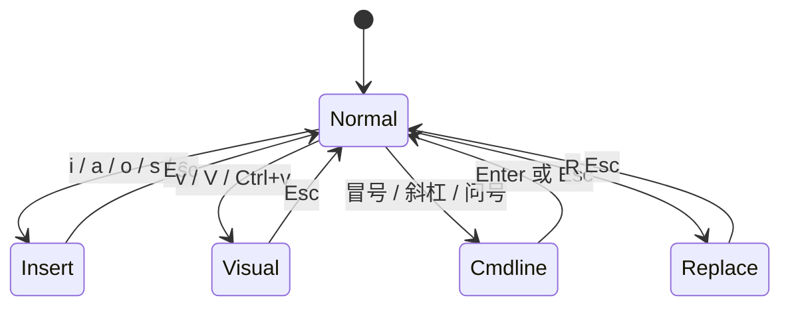
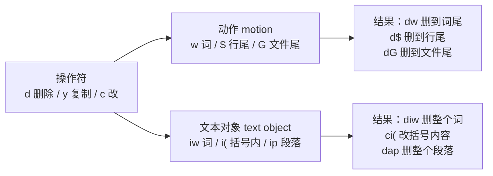
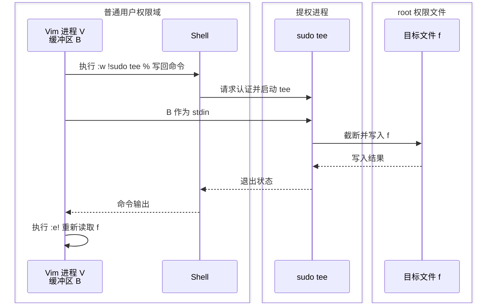

# vim

[toc]

> Linux 终端里的文本编辑器。服务器上基本都自带 `vi`，`vim`（vi improved）是它的增强版，语法高亮、多级撤销、插件系统都是 vim 加的。
> 改配置文件、写脚本、临时改一行代码，用 vim 比来回传文件快。这篇按「使用 → 常用操作 → 配置」三块记，配好一份 `.vimrc` 之后日常只需要记住十几个键位。

## 一、使用

### 模式：vim 的运转方式


vim 和记事本最大的不同在这一点：打开文件后按键不会直接写进正文，它先被当成命令执行。想打字必须显式切到插入模式。所以记快捷键之前，先把模式关系理清楚。



几个模式各自管什么：

| 模式 | 进去的方式 | 干什么 |
| --- | --- | --- |
| Normal（命令） | `Esc` | 移动、删除、复制、跳转，默认停在这里 |
| Insert（插入） | `i a I A o O s c` | 正常打字 |
| Visual（可视） | `v` `V` `Ctrl+v` | 选中一段文本再操作 |
| Command-line（命令行） | `:` `/` `?` | 执行命令、查找、替换 |
| Replace（替换） | `R` | 覆盖输入，少用 |

有一点值得记住：不管在哪个模式，`Esc` 都回 Normal，回不去就多按两下（`Ctrl+[` 等价）。这是 vim 里最省心的一条。

### 打开、保存、退出

```bash
vim 文件            # 打开或新建
vim +42 文件         # 打开并跳到第 42 行
vim + 文件           # 跳到末尾
vim -R 文件          # 只读打开（不想误改配置时用）
vim 文件1 文件2      # 一次开多个，:n 下一个，:N 上一个
```

命令行的写与退：

| 命令 | 作用 |
| --- | --- |
| `:w` | 保存 |
| `:q` | 退出（有未保存改动会报错） |
| `:wq` / `:x` / `ZZ` | 保存并退出（`x` 与 `ZZ` 在没改动时不写文件） |
| `:q!` | 放弃改动，强制退出 |
| `:w 新文件名` | 另存为 |
| `:e!` | 丢掉改动，恢复成磁盘上的版本 |

两个高频兜底：文件没改却退不掉（比如不小心按到 `Ctrl+s` 或编辑器卡住），`:q!` 能干净退出；内容改坏了想重来，`:e!` 重新读一遍磁盘。

### 基本编辑动作

Normal 模式下最常用的一小把：

```text
i    光标前插入        a    光标后插入
I    行首插入          A    行尾插入
o    下方新开一行      O    上方新开一行
x    删一个字符        dd   删一行
u    撤销              Ctrl+r  重做
```

写完一段就按 `Esc` 回 Normal，再继续移动光标。`u` 与 `Ctrl+r` 是多级撤销/重做，反复用没问题。

## 二、常用操作

vim 的键位有一个统一结构：**操作符 + 范围**。`d` 是删除、`y` 是复制、`c` 是删除并进入插入，后面跟一个动作或范围，就得到一整类命令。理解这一点，能自己推出来很多没背过的组合。



### 移动光标

```text
h j k l      左 下 上 右（记熟后就别再摸方向键）
w b e        词首 / 上一个词首 / 词尾
0 ^ $        行首 / 行首第一个非空字符 / 行尾
gg G         文件首 / 文件尾      5G 或 :5 跳到第 5 行
f x / t x    行内跳到下一个 x / 跳到 x 前一个位置，; 下一个，, 反向
%            跳转到配对的括号
{ }          上/下一段（代码里就是空行分隔的块）
Ctrl+d Ctrl+u  下半页 / 上半页（比翻整页好定位）
H M L        屏幕顶 / 中间 / 底
```

### 编辑与复制

```text
dw  d$  dG   删到词尾 / 行尾 / 文件尾
dd  5dd      删 1 行 / 5 行
yy  yw  y$   复制行 / 词 / 到行尾
p  P         粘贴到光标后 / 前（整行粘贴时是下/上一行）
diw  ciw     删除 / 替换光标所在的整个词
di"  ci(     删 / 改引号内、括号内的内容（不用管光标在不在内容里）
>>
<<           整行缩进 / 反缩进
J            把下一行接到本行
.            重复上一次修改（改一处后，下次按 . 就够）
```

`.` 是省事的一键，改格式、加标点这类重复动作，连续按 `.` 比手动改快得多。

### 查找与替换

```text
/关键词     向下查找，n 下一个，N 上一个
?关键词     反向查找
*  #        查找光标所在的词（向后 / 向前）
:noh        取消查找高亮
```

替换命令的完整写法是 `:范围s/被替换/替换/标志`，范围不写就是当前行：

```vim
:s/old/new/          " 当前行第一个
:s/old/new/g         " 当前行全部
:%s/old/new/g        " 全文全部
:%s/old/new/gc       " 全文，每个都问一次 y/n/a/q
:10,20s/old/new/g    " 第 10 到 20 行
:'<,'>s/old/new/g    " 可视模式下选中的区域（选中后按 : 会自动带上）
```

两点容易卡住：

- 文件里的 `.` `*` `[` `$` 这些在正则里有含义，字面替换要写成 `\.` `\*`；路径里的 `/` 习惯写成 `\/`，也可以换分隔符，如 `:%s#a/b#c/d#g`（`:s` 后面第一个字符就是分隔符，挑正文里不出现的字符即可）。
- 替换内容用 `&` 表示"整个匹配"，`\1` `\2` 表示正则里第 1、2 个分组。比如 `:%s/\(.*\);/\1/g` 去掉行尾分号。

### 可视模式与批量操作

```text
v        按字符选     V 按整行选     Ctrl+v 按矩形块选
```

块模式在改配置时特别顺手，比如给多行加注释：

1. `Ctrl+v` 选中这几行的第一列；
2. 按 `I` 进入插入，输入 `# `；
3. 按 `Esc`，所选每一行都会加上前缀（`A` 则是统一加在行尾）。

选中之后按 `:` 会自动补上 `:'<,'>`，接着就能对选区执行 `:sort`、`:!命令`、`:s/.../.../g` 等。

### 寄存器、宏、标记

```text
:reg          查看所有寄存器
"0            最近一次复制的内容（删除不走它，删除进 1-9）
"+  "*        系统剪贴板（Linux 上要 +clipboard 编译支持）
"ayy  "ap     复制到 a 寄存器 / 从 a 粘贴
qa ... q      把后面一串操作录到 a 寄存器，q 停止
@a  @@ 5@a    执行 a / 重复上次 / 执行 5 次
ma  'a  `a    打标记 a / 跳到 a 所在行 / 跳到 a 的精确列
```

宏适合处理一批结构相同的内容：先在一行上把动作录完（移动、替换、跳到下一行都录进去），再 `100@a` 批量跑，跑歪了就 `u` 撤销重录。

### 窗口、标签页与外部命令

```text
:sp  :vsp      水平 / 垂直分屏        Ctrl+w 后按 hjkl 切换窗口，q 关闭，= 等宽
:tabnew 文件   新标签页             gt / gT 切下一个 / 上一个
:!命令         临时执行 shell 命令（文件内容不动）
:r !命令       把命令输出读进当前缓冲区（插日期、引日志都用它）
:'<,'>!sort    把选中的行交给外部命令处理（排序、去重、格式化）
```

`:r !date`、可视选中后 `:'<,'>!sort -u` 这类组合，把 vim 的编辑能力和 shell 工具接起来，比自己写脚本省事。

## 三、配置

### 配置文件放在哪

| 系统 | 路径 |
| --- | --- |
| Linux / macOS | `~/.vimrc`，新版 vim 也认 `~/.vim/vimrc` |
| Windows | `_vimrc`（一般放在 `$HOME` 下） |

不确定时在 vim 里查：

```vim
:echo $MYVIMRC     " 当前实际加载的 vimrc 完整路径
:version           " 看编译特性、支持哪些功能
:source $MYVIMRC   " 改完 vimrc 后重新加载（:so % 也行）
```

### 常用选项

`.vimrc` 就是一堆 `set` 语句。语法很规律：`set xxx` 开启，`set noxxx` 关闭，`set xxx!` 取反切换，`set xxx?` 查询当前值（`set xxx?` 前加 `verbose` 还能看到是谁改的）。

```vim
set nocompatible            " 关掉 vi 兼容模式，放第一行
set number relativenumber   " 绝对行号 + 相对行号（跳转时算行数很省事）
set cursorline              " 高亮当前行
set laststatus=2            " 总是显示状态栏

set tabstop=4               " Tab 显示成几个空格
set softtabstop=4
set shiftwidth=4            " >> << 缩进的宽度
set expandtab               " 按 Tab 时插入空格，不插真 Tab
set autoindent              " 新行沿用上一行缩进
set backspace=indent,eol,start  " 退格能删到行首、能删换行

set ignorecase smartcase    " 搜索忽略大小写，但输入含大写就区分
set incsearch hlsearch      " 边打边跳 + 高亮所有匹配（:noh 临时关）
set wrap                    " 长行折行显示（改代码时可改 nowrap）

set mouse=a                 " 允许鼠标定位、滚轮、拖动分屏
set clipboard=unnamedplus   " 与系统剪贴板共用（Linux 上需要 vim 支持 clipboard）
set encoding=utf-8          " 内部编码
set fileencodings=ucs-bom,utf-8,gb18030,gbk  " 按顺序试探文件编码
set undofile                " 撤销记录写盘，关掉 vim 再开还能 u
```

中文乱码多出在 `encoding` 与 `fileencodings` 上：文件是 GBK 却被当 UTF-8 打开时就乱码，可以临时用 `:e ++enc=gbk` 指定编码重开一遍。乱码的成因与两平台排查见 [终端中文乱码](../环境/终端中文乱码.md)。

### 键位映射

```vim
let mapleader = " "                 " 把空格设为 leader，前缀短按起来快
nnoremap <leader>w :w<CR>           " Normal 模式下空格+w 保存
inoremap jj <Esc>                   " 插入模式连按 jj 回到 Normal
vnoremap <leader>y "+y              " 可视模式复制的都进系统剪贴板
```

`map` 会递归解释映射结果（映射结果里再含触发键时可能来回套娃），`noremap` 不递归。日常一律用 `noremap`，需要递归的场合很少。前缀 `n` `i` `v` 分别表示生效模式。

### 分文件类型设选项

不同文件缩进规则不一样，可以用自动命令按文件类型单独设：

```vim
autocmd FileType yaml setlocal ts=2 sw=2 expandtab
autocmd FileType c    setlocal ts=4 sw=4 noexpandtab
autocmd FileType make setlocal noexpandtab    " Makefile 必须是真 Tab
```

`setlocal` 只影响当前缓冲区，避免污染全局设置。

### 插件管理（vim-plug）

装插件先装管理器。vim-plug 是单文件脚本，一条命令就位：

```bash
curl -fLo ~/.vim/autoload/plug.vim --create-dirs \
  https://raw.githubusercontent.com/junegunn/vim-plug/master/plug.vim
```

然后在 `.vimrc` 里用 `plug#begin()` / `plug#end()` 包住插件清单：

```vim
call plug#begin('~/.vim/plugged')

Plug 'preservim/nerdtree'              " 侧边目录树
Plug 'tpope/vim-commentary'            " gcc / gc 注释快捷键
Plug 'morhetz/gruvbox'                 " 配色主题
Plug 'junegunn/fzf', { 'do': { -> fzf#install() } }   " 模糊查找

call plug#end()

colorscheme gruvbox
```

保存后执行 `:PlugInstall` 安装，`:PlugUpdate` 更新，`:PlugClean` 清掉已删除的插件。插件本身按需加，先配好基础选项再逐步加，一次堆一堆插件反而记不住哪个在起作用。

### root 权限文件保存

#### 定义与边界

设 Vim 进程为 $V$，运行用户为 $u$；当前缓冲区为 $B$；目标文件为 $f$，其写权限仅授予 root。普通 `:w` 在 $V$ 的权限下执行写入：

$$
\operatorname{write}_u(f) = \text{EACCES}
$$

`:w !{cmd}` 将缓冲区内容通过标准输入交给外部命令 `{cmd}`；`%` 展开为当前文件名；`sudo tee` 以 root 权限接收标准输入并写入 $f$。数据路径为：

$$
B \xrightarrow{\text{stdin}} \text{sudo tee } f \xrightarrow{\text{truncate/write}} f
$$

图 1 给出 Vim、sudo/tee 与 root 文件之间的权限边界。



**图 1：Vim 通过 `sudo tee` 写入 root 文件**

图 1 的不变量为：Vim 本身仍以普通用户运行；提权范围限定在外部 `tee` 进程；写入完成后，Vim 需重新读取磁盘文件以同步缓冲区状态。

#### 操作方式

| 场景 | 命令 | 权限边界 |
| --- | --- | --- |
| 尚未打开文件 | `sudoedit <文件>` | 编辑器以普通用户运行，保存时由 sudo 复制回原文件 |
| 接受整个编辑器以 root 运行 | `sudo vim <文件>` | Vim 进程及其子命令均取得 root 权限 |
| 已用普通用户打开并完成修改 | `:w !sudo tee % > /dev/null` | 仅外部 `tee` 进程通过 sudo 提权 |

已经打开文件时，按 `Esc` 后执行：

```vim
:w !sudo tee % > /dev/null
:e!
```

- `:w !{cmd}`：把缓冲区送到外部命令的标准输入；
- `%`：当前文件名；
- `> /dev/null`：抑制 `tee` 回显到终端的文件内容；
- `:e!`：重新读取外部命令写入后的磁盘文件。

`:w !{cmd}` 与 `:w!` 语义不同：前者把缓冲区传给外部命令，后者在 Vim 当前权限下强制写文件；`:w!` 不能绕过操作系统的文件权限。

修改系统配置前先备份：

```bash
sudo cp <文件> <文件>.bak
```

写入失败需要回滚时：

```bash
sudo cp <文件>.bak <文件>
```

验证文件内容：

```bash
grep '<配置项>' <文件>
```

## 四、vim快捷键

经典版是一系列的入门教程键位图的组合结果，下面是不同编辑模式下的键位图。


## 五、小结

1. vim 的一切从模式出发：默认 Normal，打字先按 `i`，回不去就按 `Esc`。
2. 键位符合「操作符 + 范围」的结构，`d/y/c` 配上 motion 或文本对象，能自己推出命令，不用死背。
3. 日常高频就十几个键：`i Esc :w :q u Ctrl+r / n dd yy p . gg G`。
4. 配置的收益集中在缩进、搜索、编码、行号几项上，`.vimrc` 越短越好维护。

## 自测

- Q：打开文件后按 `i` 一直在打字，想改删整行，为什么按 `dd` 没反应？
  A：还停在插入模式，先按 `Esc` 回 Normal，再按 `dd`。
- Q：删了一整行，想把它粘贴到别处怎么办？
  A：`dd` 删除的内容同时进了寄存器，移动光标后按 `p`（`P` 贴到光标前）。删除和复制共用同一套寄存器，`yy` 的内容也一样可以 `p`。
- Q：`:%s/a/b/g` 里的 `%` 表示什么？
  A：整个文件范围。不写范围是当前行，`10,20` 是行区间，`'<,'>` 是上次可视选区。
- Q：想让 Tab 键插入空格而不是真 Tab，改哪个选项？
  A：`set expandtab`，配套 `tabstop` / `softtabstop` / `shiftwidth` 一起设成同一个宽度。

## 参考资料

- [Vim 命令行手册：`:w !{cmd}` 将缓冲区作为外部命令标准输入](https://vimhelp.org/cmdline.txt.html)
- [sudo 手册：sudoedit 创建临时副本，编辑后复制回原文件](https://manpages.ubuntu.com/manpages/noble/en/man8/sudo.8.html)

## 关联

- [vscode](./vscode.md)：VS Code 能装 Vim 键位插件，先用 vim 记住的键位在图形界面里也能用。
- [终端中文乱码](../环境/终端中文乱码.md)：`encoding` / `fileencodings` 设置不对会直接表现为打开文件乱码。
- [基础命令速查](../Linux/基础命令速查.md)：终端里改文件、看文件常和 vim 搭配出现。

## 相关笔记

- [[vscode]]
