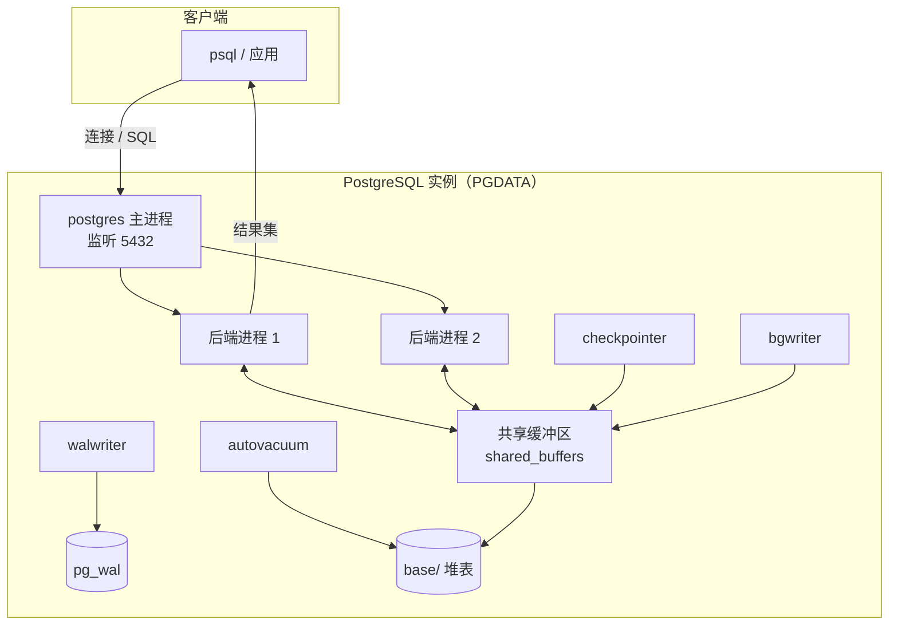

# PostgreSQL

> 费曼版一句话：一个把每张表、每个函数都当作"对象"来管理的开源数据库服务器，客户端发 SQL，它负责在磁盘上安全、并发地存取数据。

## 1. 定义与边界

**PostgreSQL** 是一个开源的**对象-关系型数据库管理系统**（Object-Relational DBMS, ORDBMS），起源于加州大学伯克利分校的 POSTGRES 项目（1986 年起，Michael Stonebraker 主持），1996 年起以 PostgreSQL 之名发布，由社区开发，许可证为类 MIT/BSD 的 PostgreSQL License。

定义的三个边界条件：

1. **ORDBMS 而非纯 RDBMS**：在关系模型（表、行、SQL）之上支持面向对象特征——表继承、复杂类型、数组、JSONB、自定义类型与自定义函数。
2. **客户端-服务器架构**：服务器是常驻进程，客户端通过 TCP（默认端口 5432）或 Unix 域套接字以会话协议通信；区别于 SQLite 那样的嵌入式库。
3. **单进程集（cluster）多数据库**：一个运行中的 PostgreSQL 实例（数据目录 `PGDATA`）可包含多个互相隔离的数据库，但一次连接只能访问一个数据库。

术语辨析：

- **数据库集簇（database cluster）**：一个 `PGDATA` 目录及其承载的全部数据库，不是"多机集群"。
- **模式（schema）**：数据库内部的命名空间，`schema → table/function/...`；数据库 ≠ schema ≠ 实例。
- **Postgres 与 PostgreSQL**：前者是历史项目名与命令名（可执行文件、主进程名仍为 `postgres`），后者是正式产品名。

## 2. 体系结构推导

### 2.1 进程模型

服务器由一组操作系统进程构成：

- **主进程 `postgres`**：监听连接、为每个新连接 fork 一个后端进程、负责启动与监管辅助进程。
- **后端进程（backend）**：每个客户端连接对应一个，解析、优化并执行该会话的查询，直至断开。
- **后台辅助进程**：
  - `checkpointer`：周期性把脏页刷盘并写检查点，缩短崩溃恢复时间；
  - `bgwriter`：异步写脏缓冲页，减轻后端进程自身的写盘压力；
  - `walwriter`：把预写日志（WAL）缓冲顺序写入磁盘；
  - `autovacuum`：清理死元组、更新统计信息（MVCC 下 UPDATE/DELETE 不就地覆盖旧版本）；
  - `stats collector`（新版本由动态统计视图机制取代）：收集行计数、访问计数等，供查询规划器选择代价最小的计划。

设客户端集合为 $C$，则后端进程集合 $B$ 满足一一对应：$|B| = |C|$。连接数很大时，进程创建与上下文切换成为代价，故生产环境通常在前端部署连接池（如 PgBouncer）。

### 2.2 逻辑结构与物理结构

逻辑层次：

$$
\text{实例（PGDATA）} \supset \text{数据库} \supset \text{schema} \supset \{\text{表, 索引, 视图, 函数}, \dots\}
$$

物理上，`PGDATA` 关键子目录：

| 路径 | 内容 |
| --- | --- |
| `base/` | 各数据库的堆表与索引文件，按数据库 OID 分目录 |
| `global/` | 集簇级共享系统表（如 `pg_database`） |
| `pg_wal/` | WAL 预写日志段（顺序写，崩溃恢复与流复制的基础） |
| `pg_xact/` | 事务提交状态（commit log） |
| `postgresql.conf` / `pg_hba.conf` / `pg_ident.conf` | 参数、认证与身份映射配置 |

### 2.3 架构图

图 1　PostgreSQL 客户端-服务器进程与存储结构



图中关键不变量：**数据页必须先进入共享缓冲区再被读写；对页的修改必须先有对应 WAL 记录落盘（WAL 优先于数据页）**，这是崩溃后能把数据库恢复到一致状态的充要条件。

## 3. 核心机制

### 3.1 MVCC（多版本并发控制）

读操作与写操作不互相阻塞：UPDATE 不就地覆盖元组，而是生成新版本（tuple version），旧版本保留直至被 vacuum 清理。每个事务在快照（snapshot）下只能看到对其可见的版本，可见性由系统列 `xmin`/`xmax`（插入/删除事务号）与事务提交状态判定。

设事务 $T$ 的快照为 $S$，元组版本 $v$ 对 $T$ 可见当且仅当：

$$
\mathrm{Visible}(v, T) \iff \mathrm{Committed}(v.xmin) \land v.xmin < S \land \big(\,v.xmax = 0 \lor \neg\mathrm{Committed}(v.xmax) \lor v.xmax \geq S\,\big)
$$

### 3.2 WAL（Write-Ahead Logging）

所有修改先写顺序日志，再改数据页。检查点之后，崩溃恢复只需重放检查点之后的 WAL（redo），并回滚未提交事务。WAL 同时是物理流复制（主从）的传输内容。

### 3.3 扩展机制

扩展（extension）以 SQL + 共享库形式向内核添加类型、函数、索引访问方法与过程语言，`CREATE EXTENSION` 即装即用。代表性扩展：PostGIS（地理空间）、pg_trgm（模糊匹配）、TimescaleDB（时序）。

## 4. 操作步骤

前置条件：已安装并初始化（`initdb`），服务器已启动；适用系统：Linux（Windows 下命令相同，路径分隔符不同）。

### 4.1 连接

```shell
# 本地连接，-U 用户 -d 数据库 -h 主机 -p 端口
psql -U postgres -d postgres -h localhost
```

### 4.2 数据库与表

```sql
CREATE DATABASE demo;
-- 连接内切换到 demo（psql 元命令）
\c demo

CREATE TABLE t (
    id    bigserial PRIMARY KEY,
    name  text        NOT NULL,
    tags  text[]
);

INSERT INTO t (name, tags) VALUES ('a', ARRAY['x', 'y']);
SELECT * FROM t;
```

### 4.3 psql 常用元命令

| 命令 | 作用 |
| --- | --- |
| `\l` | 列出所有数据库 |
| `\c dbname` | 切换数据库 |
| `\dt` | 列出当前 schema 的表 |
| `\d tablename` | 查看表结构（列、类型、索引） |
| `\dn` | 列出 schema |
| `\du` | 列出角色 |
| `\timing` | 切换语句执行耗时显示 |
| `\q` | 退出 |

### 4.4 验证

```sql
-- 查看版本与当前连接信息
SELECT version();
SELECT current_database(), current_user, now();

-- 查看服务器状态视图
SELECT pid, state, query FROM pg_stat_activity;
```

验证标准：`psql` 能连接、`CREATE DATABASE` 后在 `\l` 中出现、建表插入后 `SELECT` 返回所写行。回滚：`DROP DATABASE demo;`（需先断开到该库的连接）。

## 5. 与 MySQL 的对比辨析

| 维度 | PostgreSQL | MySQL |
| --- | --- | --- |
| 模型 | 对象-关系（继承、数组、自定义类型、JSONB） | 关系模型为主，JSON 类型较晚加入 |
| 并发控制 | MVCC，旧版本保留在表内，需 VACUUM | InnoDB MVCC，undo 段管理旧版本 |
| SQL 合规性 | 对 SQL 标准贴合度高，支持窗口函数、CTE 较早 | 近年逐步补齐，历史上有较多方言 |
| 扩展能力 | 强扩展框架（类型/函数/索引方法/过程语言） | 插件引擎（如 InnoDB/MyISAM），扩展面较窄 |
| 复制 | 基于 WAL 的物理流复制、逻辑复制 | binlog 逻辑复制、组复制 |
| 默认认证 | 初始 peer/scram-sha-256，`pg_hba.conf` 控制 | 初始 root 无密码或配置策略 |
| 典型场景 | 复杂查询、GIS、数据分析、强一致业务 | 简单 OLTP、Web 业务、读多写少场景 |

## 6. 边界与适用

- 适用：复杂查询与数据一致性要求高、需要自定义类型/扩展（GIS、时序）、希望贴合 SQL 标准的场景。
- 不适用：嵌入式单文件存储（应选 SQLite）；以极简 key-value 且无需 SQL 为唯一需求的场景。
- 常见误解：
  - "VACUUM 是故障"——它是 MVCC 的必要维护环节；autovacuum 默认开启，长事务会阻止死元组清理，导致表膨胀。
  - "schema 就是数据库"——schema 是数据库内的命名空间，一个数据库可含多个 schema。
  - "建了索引就一定快"——规划器按代价选择计划，统计信息过期或低选择性列上的索引可能不被使用。

## 7. 思维模型迁移

- **WAL 模型（先写日志再改状态）**：适用于任何需要崩溃恢复的状态系统，如文件系统 journal（ext4、XFS）、LSM 存储的写前记录、分布式系统的操作日志。
- **MVCC 快照思想**：适用于无锁读多写少的并发设计，如软件事务内存（STM）、Git 的版本快照、配置中心的版本化发布。

## 8. 自测

- Q1：为什么一个客户端连接对应一个后端进程？连接数过大时瓶颈是什么？
- A1：主进程 fork 独立后端以隔离会话状态与信号；连接数过大时进程内存、上下文切换与调度开销上升，应引入连接池。
- Q2：WAL 为什么必须先于数据页落盘？
- A2：若数据页先落盘而崩溃发生在日志写入前，修改无法重做也无法识别，一致性不可恢复；WAL 先行使恢复可由重放完成。
- Q3：PostgreSQL 中频繁 UPDATE 后为什么需要 VACUUM？
- A3：MVCC 下 UPDATE 产生新版本、旧版本成为死元组，占用空间且影响扫描，VACUUM 回收死元组并冻结过老事务号。

## 9. 参考

- PostgreSQL 官方文档：<https://www.postgresql.org/docs/>（访问于 2026-10-29）
- 体系结构（内部概览）：<https://www.postgresql.org/docs/current/runtime-config-resource.html> 与手册第 19 章（服务器配置）、第 50 章（物理存储结构）

## 相关笔记

- [[mysql]] — 关系型数据库对照
- [[软件安装部署]] — Linux 服务部署
