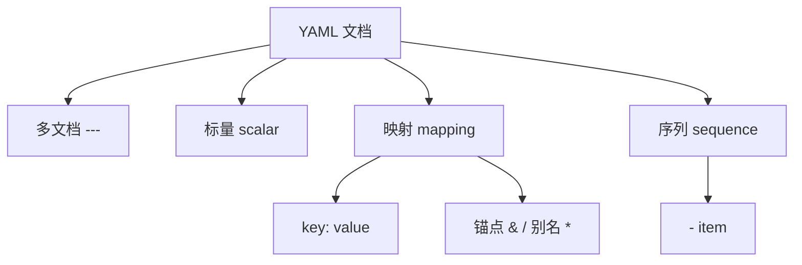

# YAML

> 费曼版一句话：YAML 是靠缩进表达层级、供人阅读的配置数据格式，`.yml` 与 `.yaml` 是它的两种文件后缀。

## 定义

YAML（YAML Ain't Markup Language）是一种人类可读的数据序列化格式，用于表示标量、映射与序列三类结构。文件后缀 `.yaml` 与 `.yml` 等价：前者为正式写法，后者为缩短写法，主流解析器同时识别两者。

常见载体：`docker-compose.yml`、GitHub Actions 的 `.github/workflows/*.yml`、Ansible playbook、ESP-IDF 的 `idf_component.yml`、Elasticsearch 的 `elasticsearch.yml`，以及本仓库 Markdown 头部的 frontmatter（YAML 语法，但嵌在 Markdown 中，文件后缀仍为 `.md`）。

## 原理

YAML 的数据模型由三种节点构成，其余语法都是这三者的组合：

- **标量（scalar）**：字符串、数值、布尔、`null`。
- **映射（mapping）**：键值对，写作 `key: value`。
- **序列（sequence）**：有序列表，写作 `- item`。

层级由行首缩进决定，缩进量不限，但同一层级必须一致。缩进只允许空格，禁止制表符。

```yaml
server:
  host: 127.0.0.1
  ports:
    - 80
    - 443
  tls: true
```

**类型推断。** 未加引号的标量由解析器按规则推断类型，这带来歧义：`yes`、`no`、`on`、`off` 在 YAML 1.1 中被解析为布尔；`1.10` 被解析为浮点数 `1.1`；`2026-10-20` 被解析为日期。强制字符串须加引号。

**跨文档与复用。** `---` 分隔多个文档，`#` 开始注释；锚点 `&name` 定义节点，别名 `*name` 引用，合并键 `<<` 复用映射。

## 心理表征（画出来）



数据结构为树：映射与序列构成内部节点，标量为叶节点；缩进定义父子关系。

## 要点

- 缩进只用空格，禁用 Tab。
- `key:` 的冒号后必须跟一个空格，再写值。
- 列表项写作 `- `，短横线后跟一个空格。
- 含 `:`、`#`、`@` 等特殊字符或需保留前导零时，值加引号。
- `---` 分隔文档，`...` 结束文档，`#` 注释。
- 重复键的行为由实现决定（覆盖或报错），应避免。

## 边界与反例

- **Tab 缩进**：解析器直接报错，因 Tab 宽度依赖环境，无法稳定确定层级。
- **Norway 问题**：国家代码 `NO` 在 YAML 1.1 中被解析为布尔 `false`；写入国家代码须加引号。
- **版本号**：`1.10` 解析为 `1.1`，版本号一律加引号。
- **缩进不一致**：同层缩进量不同，树结构被错误切分。
- **性能**：YAML 解析成本高于 JSON，不适合大数据量或高频数据交换。

## 对比辨析

| 维度 | YAML | JSON | TOML | INI |
| --- | --- | --- | --- | --- |
| 可读性 | 高 | 中 | 高 | 高 |
| 注释 | 支持 | 不支持 | 支持 | 支持 |
| 类型 | 隐式推断 | 显式 | 显式 | 基本为字符串 |
| 层级 | 缩进 | 括号 | 表与数组 | 单层 section |
| 典型用途 | 配置、CI | API、数据交换 | 配置 | 简单配置 |

## 思维模型迁移

"隐式语法换简洁"是一个可迁移的权衡模型：省略显式标记能降低书写与阅读成本，代价是解析歧义与对规则的高度依赖。同类设计见于 Python 的缩进、Makefile 的 Tab、shell 的单词拆分。使用这类格式时，先确认解析规则，再动手写。

## 自测

- Q：`.yml` 与 `.yaml` 有实质区别吗？
  A：无。两者指向同一格式，解析器通常都识别。
- Q：为什么 YAML 禁止 Tab 缩进？
  A：缩进承担结构语义，Tab 的显示宽度不固定，无法稳定确定层级。
- Q：如何写一个包含两个元素的端口列表？
  A：

```yaml
ports:
  - 80
  - 443
```

- Q：`version: 1.10` 会得到什么？
  A：浮点数 `1.1`；版本号须写成 `version: "1.10"`。

## 参考

- YAML 1.2 规范：https://yaml.org/spec/1.2.2/
- Docker Compose 文件参考：https://docs.docker.com/compose/compose-file/
