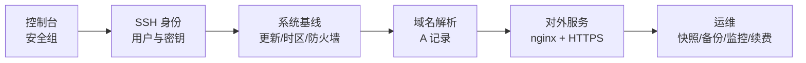

# 从零上手

> 刚买到的实例只具备网络可达性，身份、系统基线、对外服务与运维策略均为空。上手过程按依赖顺序逐层补齐，任何一层的缺失都会表现为"连不上"或"打不开"。
> 本机实例的 IP、域名与配置进度见 [self/local.md](../../self/local.md)（本地，不入库）。

## 零、依赖顺序



端口从外网可达的充要条件为三个条件的合取：

```text
可达(端口 p) ⇔ 安全组放行(p) ∧ 系统防火墙放行(p) ∧ 进程监听(0.0.0.0:p)
```

三个条件分别由云厂商、操作系统、应用控制，排查时逐项验证，任一项不成立即不可达。

## 一、控制台与网络

阿里云 ECS 的控制台入口：实例详情页提供远程连接（Workbench / VNC）、重置密码、安全组、快照、监控。首次登录优先用 Workbench 或 VNC，不依赖本地 SSH 配置。

安全组是实例外层的包过滤，入方向默认仅放行少量端口，规则以"协议 + 端口 + 源地址"描述：

| 用途 | 协议/端口 | 源地址 | 说明 |
| --- | --- | --- | --- |
| SSH | TCP 22 | 自己的公网 IP/32 | 不要对 0.0.0.0/0 开放，扫描器会持续爆破 |
| HTTP | TCP 80 | 0.0.0.0/0 | 签发证书与跳转 HTTPS |
| HTTPS | TCP 443 | 0.0.0.0/0 | 对外服务 |
| 数据库/缓存 | TCP 3306/6379 等 | VPC 内网地址段 | 禁止对公网开放 |

公网 IP 与私网 IP 的关系：ECS 的公网地址通过 NAT 映射，**不会配置在网卡上**，因此 `ip addr` 只显示主私网 IP（本机为 `<私网IP>`）。内网互通、容器与数据库连接一律使用私网地址。

计费上，公网带宽分"固定带宽"与"按使用流量"两种，包年包月实例通常配固定带宽。带宽上限决定并发传输速率，超出后表现为排队而非额外扣费（按流量计费则相反）。

## 二、首次登录与身份

阿里云 Ubuntu 镜像默认以 `root` 登录（具体以镜像说明为准）。直接长期使用 root 违反最小权限原则，第一步是建立普通用户：

```bash
# 服务器上，以 root 执行
adduser dev
usermod -aG sudo dev
```

随后把本地公钥写入该用户，之后全部操作走密钥：

```bash
# 本地执行
ssh-keygen -t ed25519 -C "ecs"
ssh-copy-id dev@<公网IP>
ssh dev@<公网IP>
```

确认密钥登录可用后，再关闭密码与 root 登录：

```bash
sudo cp /etc/ssh/sshd_config /etc/ssh/sshd_config.bak
sudo vi /etc/ssh/sshd_config
#   PermitRootLogin no
#   PasswordAuthentication no
#   PubkeyAuthentication yes
sudo sshd -t          # 先校验语法
sudo systemctl restart ssh
```

**保持一个已登录的会话不关**，另开终端验证新配置能登录，再关闭旧会话。配置若写错，通过控制台 VNC 登录并还原备份。完整细节见 [[ssh]]。

可选加固：安装 `fail2ban`，对多次失败的来源地址做临时封禁；改 SSH 端口只能减少日志噪声，不能替代密钥认证。

> 本地网络封锁出站 22 时，服务端配置正确也连不上。用 `portquiz.net:22` 与 `portquiz.net:2222` 对照即可判定，处置见 [[SSH连不上]]。

## 三、系统基线

```bash
sudo apt update && sudo apt full-upgrade -y
sudo timedatectl set-timezone Asia/Shanghai
sudo timedatectl set-ntp true
sudo hostnamectl set-hostname <主机名>
sudo reboot
```

4 GiB 内存运行常规 Web 服务与数据库足够；需要本地编译大型项目时可加 2–4 GiB swap：

```bash
sudo fallocate -l 2G /swapfile
sudo chmod 600 /swapfile
sudo mkswap /swapfile
sudo swapon /swapfile
echo '/swapfile none swap sw 0 0' | sudo tee -a /etc/fstab
swapon --show
```

自动安全更新（只装安全补丁，不自动重启）：

```bash
sudo dpkg-reconfigure --priority=low unattended-upgrades
```

系统防火墙用 `ufw`，默认拒绝入站、放行出站：

```bash
sudo ufw default deny incoming
sudo ufw default allow outgoing
sudo ufw allow OpenSSH
sudo ufw allow 'Nginx Full'
sudo ufw enable
sudo ufw status verbose
```

`ufw` 与安全组是两道独立的过滤层，规则必须同时放行；只改其中一层是"端口不通"的最常见原因，排查方法见 [[端口与进程]]。

## 四、域名解析与备案

域名到 IP 的映射由 DNS 记录完成。对外提供 Web 服务至少需要两条 A 记录：

| 主机记录 | 类型 | 值 | TTL |
| --- | --- | --- | --- |
| `@` | A | 公网 IP | 600 |
| `www` | A | 公网 IP | 600 |

在域名注册商或 DNS 服务商的控制台添加，随后验证：

```bash
dig +short <域名>
dig +short www.<域名>
getent hosts <域名>
```

解析生效时间的上界为沿途各缓存 TTL 之和，实践中以十分钟量级估计；修改记录后立即用 `dig @8.8.8.8` 指定公共 DNS 查询可绕开本地缓存。

备案：实例位于中国大陆地域时，域名指向该实例对外提供 Web 服务须完成 ICP 备案，未备案的 80/443 访问会被阻断；香港及海外地域不需要。备案要求域名已完成实名认证、后缀在工信部批复列表内，并从 ECS 控制台申请备案服务号（包年包月实例需满足时长与带宽门槛）。后缀能否备案以备案系统的校验结果为准。

## 五、对外服务与 HTTPS

最小可用闭环用 nginx 验证链路：

```bash
sudo apt install -y nginx
sudo systemctl enable --now nginx
curl -I http://127.0.0.1
curl -I http://<域名>
```

两条命令的区别在于验证层级：前者验证进程与端口，后者额外验证安全组、防火墙与 DNS。

证书用 Let's Encrypt 免费签发，certbot 会自动改写 nginx 配置并配置续期：

```bash
sudo apt install -y certbot python3-certbot-nginx
sudo certbot --nginx -d <域名> -d www.<域名>
sudo certbot renew --dry-run
```

签发依赖 80 端口可达与 DNS 已生效；同一域名短时间重复申请会触发速率限制，失败后先排查再重试。

服务托管有两种方式：`systemd` 直接管理进程，或 [[docker]] 容器化。容器部署时注意两点：

- **ufw 失效**：Docker 直接写 `iptables` 的 `DOCKER` 链，绕过 `ufw` 的入站规则。发布端口应绑定 `127.0.0.1:端口`，由 nginx 反代，或在 `DOCKER-USER` 链中显式限制来源。
- **网段冲突**：`docker0` 默认使用 `172.17.0.0/16`。若 ECS 私网网段落在该区间（阿里云 VPC 常从 `172.16.0.0/12` 切分），容器路由会与 VPC 路由冲突，需在 `/etc/docker/daemon.json` 中改 `bip` 或 `default-address-pools` 后重启 Docker。

监听地址决定暴露面：`127.0.0.1:p` 仅本机可达，`0.0.0.0:p` 对全部网卡可达。数据库、管理面板一律选前者。

## 六、运维与成本

- **快照**：变更前打系统盘快照，可回滚整机状态。快照按容量计费，长期保留会持续产生费用。
- **备份**：快照与备份解决不同问题，前者防误操作，后者防数据丢失。重要数据保持"三份副本、两种介质、一份异地"。
- **监控**：云监控看 CPU、带宽、磁盘；可用 Uptime Kuma 或外部探活补充应用层可用性。
- **日志**：`journalctl -u nginx --since today`、`/var/log/nginx/`。日志增长会占满磁盘，按需配置轮转。
- **到期**：包年包月到期后实例先停机，宽限期结束即释放，磁盘数据一并删除。到期前设置提醒，或在控制台开启自动续费。
- **端口限制**：阿里云默认封禁出方向 25 端口，自建邮件服务需单独申请；建站不受影响。

## 七、配置清单

- [ ] 记录实例规格、地域、到期日（写入 `self/local.md`）
- [ ] 安全组只放行必要端口，SSH 限制来源
- [ ] 创建普通用户并配置密钥登录
- [ ] 关闭 root 登录与密码登录，保留一个可用会话验证
- [ ] 系统更新、时区、主机名、swap
- [ ] `ufw` 启用并放行 SSH/HTTP/HTTPS
- [ ] 域名添加 A 记录并用 `dig` 验证
- [ ] 中国大陆地域完成 ICP 备案
- [ ] nginx 跑通，申请证书并验证自动续期
- [ ] 变更前快照，重要数据异地备份
- [ ] 设置到期提醒

## 自测

- Q：安全组与 `ufw` 都放行了 80，浏览器仍无法访问，可能原因有哪些？
  A：服务未启动；进程只监听 `127.0.0.1`；DNS 未生效或指向错误；未备案被阻断；源地址被安全组规则顺序覆盖。
- Q：为什么 `ip addr` 看不到控制台显示的公网 IP？
  A：公网地址由 NAT 映射到私网地址，不配置在网卡上；对内通信一律用私网 IP。
- Q：修改 DNS 记录后为何部分网络仍解析到旧地址？
  A：沿途递归 DNS 缓存尚未过期，等待时间不超过记录 TTL。
- Q：为什么 `ufw` 放行了端口，Docker 容器仍可从公网访问或被意外暴露？
  A：Docker 直接操作 iptables，绕过 ufw 链；应绑定 `127.0.0.1` 或配置 `DOCKER-USER` 规则。

## 关联

- [[服务器基础与选型]]：实例规格与线路参数的取舍依据。
- [[免费低价方案对比]]：购买渠道与价格判断。
- [[ssh]]：登录、密钥、客户端别名与加固细节。
- [[docker]]：容器部署与网络配置。
- [[端口与进程]]：端口监听与连通性排查。
- [[SSH连不上]]：出站端口封锁、安全组与凭据三层的定位方法。
- [[配置记录]]：这台实例的实际操作日志与当前状态。
- 实例的私密信息与进度：[self/local.md](../../self/local.md)（本地，不入库）。
