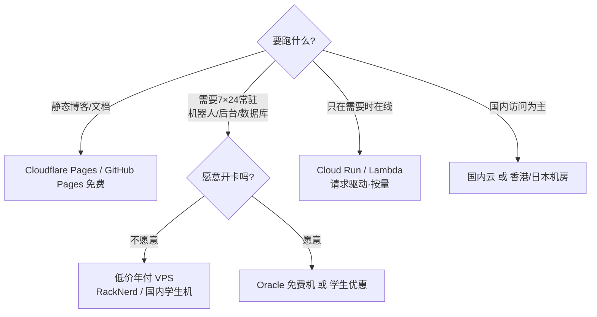

# 免费低价方案对比

> 免费获取和低价之间做选择，关键看两件事：这台机器要不要 7×24 常驻、你愿不愿意留一张卡。
> 下面把能拿到的渠道按"免费 → 学生价 → 低价年付"排开，对照着挑。

> 价格与活动随时在变，本文数值核实于 2026 年 10 月，下单前以商家页面为准。

## 一句话区分

- **永久免费**：几乎都绑定"要么会休眠、要么有额度限制、要么需要外币信用卡"，适合学习和轻量静态站。
- **短期试用 / 学生价**：门槛低、价格低，缺点是限新用户、限时长、可能限身份。
- **低价年付**：真正能长期 7×24 跑服务的选择，一年几十到上百元。

## 对比表

### 一、永久免费与免费容器

| 渠道 | 免费额度 | 常驻能力 | 需要绑卡 | 备注 |
| --- | --- | --- | --- | --- |
| Oracle Cloud Always Free | ARM Ampere A1 合计 2 OCPU + 12GB，另 2 台 AMD micro，200GB 块存储 | 可 7×24 | 需外币信用卡 | 2026-06 从 4 核 24G 减半；闲置 7 天可能被回收；热门区常"容量不足"开不出 ARM |
| Cloudflare Pages | 静态站无限带宽、每月 500 次构建 | 静态，无需常驻 | 不需要 | 托管博客/文档首选 |
| Cloudflare Workers | 每天 10 万次请求，每次 10ms CPU | 事件驱动 | 不需要 | 边缘函数，非标准 Node |
| Render | 每月 750 实例小时，512MB | 15 分钟无请求休眠 | 需要 | 免费数据库 30 天后过期 |
| Railway | 首 30 天 $5 试用，之后 $1/月额度 | 额度用完即停 | 免费档不需要 | 部署体验好，额度很小 |
| Koyeb | 1 个免费服务，512MB | 1 小时空闲缩放至零 | 需 $29 预授权 | 免费档已收紧 |
| Fly.io | 已取消永久免费，仅 7 天试用 | — | 需要 | 最小付费机约 $2/月 |
| Google Cloud Run / AWS Lambda / Azure | 每月数百万请求级免费额度 | 请求驱动 | 需要 | 按量计费，超额即收费 |

结论：想**完全不花钱且不开卡**，静态站用 Cloudflare Pages，跑 API 用 Render 或 Railway；想要一台真正的 7×24 免费服务器，只有 Oracle，但要接受被回收的风险。

### 二、国内云厂商免费试用（短期）

| 厂商 | 免费额度 | 时长 | 条件 |
| --- | --- | --- | --- |
| 阿里云 | 个人 300 元额度 / 轻量 1 个月；企业 660 元 | 1–3 个月 | 新用户 + 实名 |
| 腾讯云 | 轻量 2核2G 1 个月 | 1 个月 | 新用户 + 实名 |
| 华为云 | 1核2G / 2核4G，每日 9:30 限量 | 30 天 | 新用户 + 实名 |
| 移动云 / 百度云 / 京东云 | 类似免费试用 | 1 个月 | 新用户 |

试用到期前**必须停止或释放实例**，否则自动转按量计费。

### 三、学生优惠（需学信网认证）

| 厂商 | 代表配置 | 价格 | 续费 |
| --- | --- | --- | --- |
| 阿里云 | 轻量 2核2G3M | 99 元/年 | 同配置续费同价（活动截至 2027-03-31） |
| 阿里云 | 300 元无门槛券/年 | — | 可抵扣部分云产品 |
| 腾讯云（云+校园） | 轻量 2核2G4M | 74.88 元/年 | 学籍有效可续 |
| 腾讯云（云+校园） | 轻量 2核4G5M | 156 元/年 | 学籍有效可续 |
| 华为云 | HECS 学生版 2核2G2M | 9 元/月 | 按月，学生价可维持 |
| 海外 | Azure for Students、GitHub Student Pack 等 | $100 额度等 | 视平台 |

学生认证通常限 1 台、24–25 周岁以下，毕业后自动失效。

### 四、低价年付（海外，无需备案）

| 商家 | 配置 | 价格 | 折合月价 | 特点 |
| --- | --- | --- | --- | --- |
| RackNerd | 1核 1G / 20G / 3T | $21.99/年 | ≈13 元 | 无脑入门，支付宝，续费不涨 |
| CloudCone | 1核 1G / 55G | $14.24/年 | ≈8 元 | 大硬盘，适合备份 |
| Vultr | 1核 512M | $2.5–6/月 | 按小时 | 30+ 机房，随开随删，适合折腾 |
| 搬瓦工 | 1核 1G / CN2 | $49.99/年 | ≈30 元 | 国内速度好 |
| 狗云 / AkileCloud / DMIT / Evoxt | 各档 | ¥7.5/月起 | — | 香港/日本优质线路档位多 |

### 五、低价年付（国内，建站需备案）

| 商家 | 配置 | 价格 | 备注 |
| --- | --- | --- | --- |
| 阿里云轻量 | 2核2G200M峰值 | 38 元/年（秒杀）/ 68 元/年（常规） | 新用户，限购 1 台 |
| 阿里云 ECS | 2核2G3M | 99 元/年 | 续费同价 |
| 腾讯云轻量 | 4核4G3M | 109 元/年，秒杀 38 元/年 | 新用户首单 |
| 腾讯云轻量 | 2核2G4M | 99 元/年 | 续费同价，新老同享 |

## 判别方法

## 常见混淆点

- **把"端口带宽"当"可用速度"**：海外机标 1Gbps 是端口上限，实际速度受线路和晚高峰影响。
- **只按标价比价**：年付、季付、月付混在一起比，结论会完全错；统一折算成月价再比。
- **白天测速就下单年付**：普通线路白天能跑满、晚 8–11 点可能掉到十分之一，年付前一定晚高峰复测。
- **忘了关自动续费**：试用到期后自动转按量计费，费用可能远超预期。
- **迷信"永久免费"**：Oracle 会回收闲置实例，免费容器会休眠，重要数据不要只放在免费机上。

## 自测

- Q：想搭一个只在有人访问时才响应的 API，不想开信用卡，选哪个？
- A：Render（750 小时/月，休眠后按请求唤醒）或 Cloudflare Workers。
- Q：在校学生，想用一年，国内访问为主，怎么组合最省？
- A：优先腾讯云云+校园或阿里云学生机，两者都支持续费同价；只是短期学习可叠加华为云按月 9 元。

## 链接

- 相关：[[服务器基础与选型]]、[[从零上手]]
- 入口：[服务器 MOC](./MOC.md)

## 相关笔记

- [[服务器基础与选型]]
