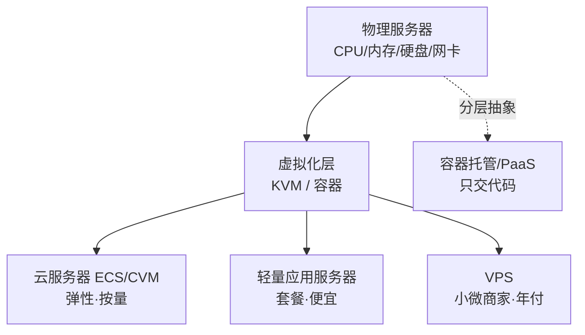

# 服务器基础与选型

> 费曼版一句话：服务器就是一台一直开着机、带公网地址、别人能连上去的电脑，你坐在自己电脑前，通过命令行远程操作它。

## 定义

服务器本身只是一种用途称呼：长期开机、对外提供服务的计算机。个人能买到的"服务器"几乎都是**租来的虚拟机**，按形态分几类：

| 名称 | 是什么 | 代表 |
| --- | --- | --- |
| VPS（虚拟专用服务器） | 一台物理机用虚拟化切成多台，每台给独立系统和 root | RackNerd、Vultr、搬瓦工 |
| 云服务器 / ECS / CVM | 云厂商的弹性实例，可随时升降配、按量计费、配套网络存储 | 阿里云 ECS、腾讯云 CVM |
| 轻量应用服务器 | 云厂商的"套餐化"便宜版，套餐固定、面板简单，适合个人 | 阿里云轻量、腾讯云 Lighthouse、华为云 Flexus |
| 独立服务器 / 独服 | 整台物理机给你，性能和带宽顶配，价格高 | 各种 IDC |
| 虚拟主机 / 空间 | 只给一个网站运行环境，没有 root，不能装任意软件 | 老式建站商 |
| 容器托管 / PaaS | 你只交代码或镜像，平台负责机器，按用量或免费额度算 | Render、Railway、Fly.io |

对个人练手来说，日常接触的是前三类。

## 原理

核心是**虚拟化**：物理机的 CPU、内存、硬盘、网卡被切分，分给多个互相隔离的实例。切法主要有两种：

- **KVM（全虚拟化）**：每个实例有独立内核，能自定义系统、装任意内核模块，行为和真机接近。正规 VPS、云服务器多用它。
- **OpenVZ / LXC（容器式）**：多个实例共享宿主机内核，超卖严重、便宜，但不能改内核、资源常被争抢。

云厂商卖的是同一批物理机的切分结果，为了利润普遍存在**超卖**：卖出去的总资源超过实际硬件。这就是为什么同规格机器，便宜商的性能波动更大。

网络上有两个和体感强相关的概念：

- **带宽 / 流量**：国内机常按固定带宽（Mbps）+ 流量包卖；海外机常给一个带宽端口（如 1Gbps）+ 每月流量（如 3TB）。
- **线路**：数据从你的宽带运营商到机房走哪条路。普通国际线路晚高峰容易拥堵；CN2 GIA、AS9929、CMIN2 这类优质回程线路贵得多，表现也稳得多。低价机的价差主要就出在线路上。

## 心理表征（画出来）

## 要点

挑机器时，下面这些参数决定体验，按重要性排：

- **线路**：国内访问为主，先看回程线路（CN2 GIA > AS9929/CMIN2 > 普通 BGP > 普通国际）。纯练手、不在意速度可忽略。
- **地域**：香港 / 日本 / 新加坡离国内近、延迟低，且**不用备案**；美国便宜、延迟高。国内机房建站要备案。
- **带宽 / 流量**：注意商家给的是"端口带宽"还是"月流量"，超流量可能限速或额外计费。
- **CPU、内存**：个人练手 1 核 1G 起步，跑 [[docker]]、数据库建议 2 核 2G 起。
- **硬盘**：SSD / NVMe / ESSD，20G 起；要装很多镜像或存数据看大小，备份/网盘类场景看大硬盘款。
- **计费方式**：包年包月（便宜但锁周期）、按量（按小时/秒，随开随删，适合折腾）、竞价/抢占（更便宜但会被回收）。
- **IP**：区分原生 IP 与广播 IP；部分商家支持付费换 IP。
- **备案**：国内机房对外建站需 ICP 备案；港澳台及海外机房不需要。

## 边界与反例

- 只是托管静态博客 / 文档站：不需要买服务器，Cloudflare Pages、GitHub Pages 免费且不限带宽，见 [[免费低价方案对比]]。
- 需要长期常驻、7×24 在线的服务（机器人、后台任务、数据库）：免费容器多数会休眠，最终还是要一台 VPS 或云服务器。
- 想省钱又执着于"永久免费"：Oracle 免费机随时可能被回收，别放重要数据。
- 常见误解：以为"云服务器"一定比 VPS 好。同一档位下，线路和实际 CPU 独占度比名称更重要。

## 对比辨析

| 维度 | 轻量应用服务器 | 云服务器 ECS/CVM |
| --- | --- | --- |
| 售卖方式 | 固定套餐打包 | 按需组合，可升降配 |
| 上手难度 | 面板简单，适合个人 | 配置项多，偏专业 |
| 带宽 | 固定或峰值带宽 + 流量包 | 可选弹性带宽 |
| 价格 | 更低，常做秒杀 | 灵活但通常更贵 |
| 适合 | 博客、小项目、练手 | 需要灵活网络/多实例 |

> 容器托管 vs VPS：前者省运维但要迁就平台，后者自由但要自己维护，见 [[从零上手]]。

## 思维模型迁移

"云"的本质是**资源的切分与超卖**：把一台物理机的资源拆开、卖多次。理解这一点，就能解释为什么便宜机性能会飘、为什么"共享"比"独占"便宜、为什么晚高峰会卡。同一种"共享带宽/共享算力"的模型，在小区宽带、共享充电宝、拼车这些场景里都能看到。

## 自测

- Q：只有 1 核 1G 的预算，想跑一个 7×24 在线的 Telegram 机器人，选免费容器还是低价 VPS？
- A：选 VPS。免费容器会休眠，机器人需要常驻监听端口。
- Q：同样 1 核 1G，为什么一台月付 13 元、一台月付 40 元？
- A：差价主要买在线路上，其次在是否超卖、机房地域、IP 质量。

## 参考

- 各厂商产品页：阿里云轻量/ECS、腾讯云 Lighthouse/CVM、华为云 Flexus、Oracle Cloud Free Tier
- 线路科普与比价：VPS 相关测评论坛、比价站
