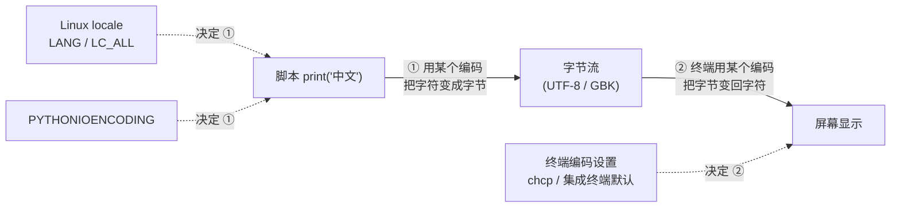

# 终端中文乱码

[toc]

> 场景：Windows Terminal 打开 WSL2 Ubuntu，在 Trae 集成终端里运行脚本输出中文时出现乱码。

## 现象

脚本本身能跑，`print("中文")` 不报错，但终端里中文变成看不懂的乱码，例如 `涓枃`、`ä¸æ–‡` 或一堆 ``。

## 原理：乱码的本质

乱码不是数据坏了，而是**同一段字节被两种不同的编码各自解释了一遍**。

一个中文字符，计算机里存的是一串字节（bytes）。把字符变成字节叫**编码**，把字节变回字符叫**解码**。编码和解码必须用同一种规则（UTF-8、GBK 等），否则字节对不上字符，显示的就不是原来的字。

所以中文输出要经过一条链路，任何两环的编码规则对不上，就会乱码：



### 两个容易混淆的概念

- **乱码**：编码和解码规则不同，但字节恰好都是"合法字节"，于是不报错、只显示错。UTF-8 和 GBK 各成一串合法字节，互相错读就乱码。
- **报错**：如果 Python 的 stdout 编码被限制成 ASCII，而内容是中文，会直接抛 `UnicodeEncodeError`，这不是乱码，是另一类问题（编码没声明够）。

### 两种典型乱码形态，帮你判断方向

| 看到的样子 | 实际发生了什么 |
| --- | --- |
| `中` 变成 `涓`、`锟斤拷` | 程序输出 **UTF-8** 字节，终端用 **GBK** 去解 |
| `中` 变成 `ä¸æ–‡`、`` | 程序输出 **GBK** 字节，终端用 **UTF-8** 去解 |

先认准方向，再动手改，就不容易改成反效果。

## 排查：定位是哪一环不一致

按顺序跑三行命令，逐一核对：

```bash
# 1. Linux 当前用什么 locale（决定程序 stdout 编码的关键）
locale
echo $LANG

# 2. Python 实际往 stdout 写字节时用什么编码
python3 -c "import sys; print(sys.stdout.encoding)"

# 3. 脚本文件本身是什么编码（源码编码和运行时输出是两回事）
file -i 你的脚本.py
```

- 第 1、2 步输出不是 `UTF-8` 结尾 → locale / Python 环境问题，走方案一、二。
- 第 3 步不是 `utf-8` → 源文件编码问题，走方案三。
- 三个都是 UTF-8，但终端仍乱码 → 终端侧编码问题，走方案四。

## 解决

### 方案一：把 Linux locale 统一到 UTF-8（根治，推荐）

```bash
# 生成中文 UTF-8 locale（没有才需要生成）
sudo locale-gen zh_CN.UTF-8
# 持久化
sudo update-locale LANG=zh_CN.UTF-8
# 当前会话立即生效
export LANG=zh_CN.UTF-8
export LC_ALL=zh_CN.UTF-8
```

再配合 Python 显式声明输出编码：

```bash
export PYTHONIOENCODING=utf-8
```

想永久生效，把这三行 `export` 追加到 `~/.bashrc`：

```bash
echo 'export LANG=zh_CN.UTF-8
export LC_ALL=zh_CN.UTF-8
export PYTHONIOENCODING=utf-8' >> ~/.bashrc
source ~/.bashrc
```

### 方案二：脚本内兜底（不依赖环境）

环境不方便统一时，在 Python 脚本里直接指定输出编码，只影响本脚本：

```python
import sys
sys.stdout.reconfigure(encoding='utf-8')
print("中文")
```

### 方案三：修复源文件编码

如果报 `SyntaxError: Non-UTF-8 code` 或注释里的中文也乱，说明源码文件不是 UTF-8。把文件用 UTF-8 保存，并在文件首行声明：

```python
# -*- coding: utf-8 -*-
print("中文")
```

### 方案四：终端侧编码

- **Trae / VS Code 集成终端**：默认就是 UTF-8，一般不用改；若被改过，检查设置里的 `files.encoding` 和终端编码是否为 `utf8`。
- **Windows CMD / PowerShell**：默认是 GBK（代码页 936），临时切换：

```bash
chcp 65001
```

## 小结

乱码的根因永远只有一个：**把字符变字节的人，和把字节变字符的人，用了两套编码**。排查顺序是「locale → Python stdout → 源文件 → 终端」，把四者统一成 UTF-8，问题必消。

编码系统的概念（字符集 vs 编码方案、Unicode 与 UTF 的区别）见 [杂谈](../Linux/杂谈.md) 的「编码系统」一节。