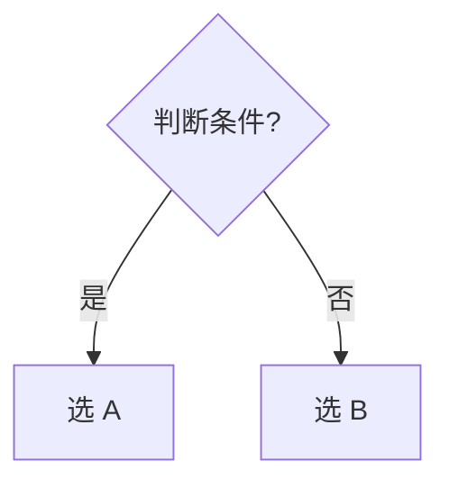

# A vs B

> 对比学习法：辨别力来自对照。把容易混的概念并排放，差异才会显形。

## 一句话区分

用一句话说清 A 和 B 最本质的区别。

## 对比表

| 维度 | A | B |
| --- | --- | --- |
| 定义 |  |  |
| 适用场景 |  |  |
| 优点 |  |  |
| 局限 |  |  |
| 典型误用 |  |  |

## 判别方法

遇到实际场景，怎么快速判断该用哪个？给可操作的口诀或判断步骤。

## 常见混淆点

- 为什么这两个容易被混？它们在哪一点上长得像？

## 自测

- Q：下面这个场景该用 A 还是 B？
- A：

## 链接

- 相关概念：[[]]