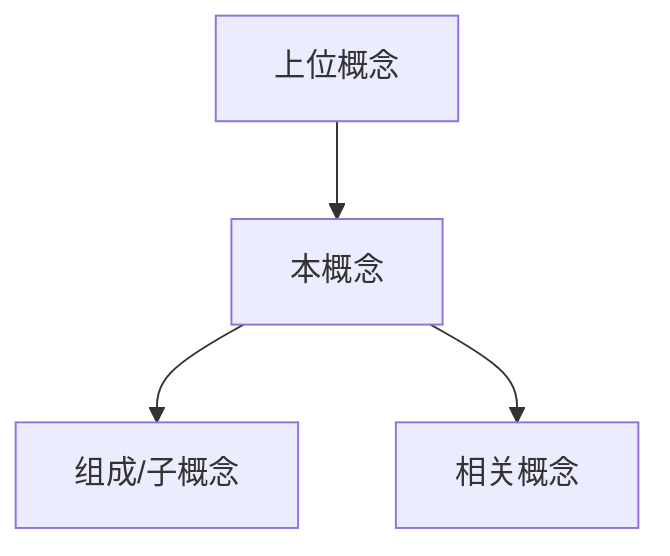

# 概念名

> 费曼版一句话：用外行能听懂的话说清它是什么。

## 定义

正式定义，注明出处。定义要精确到能区分它和相邻概念。

## 原理

用自己的话讲清它怎么工作、为什么是这样。这里的"用自己的话"不是修辞要求，是学习机制本身——重写才产生记忆。

## 心理表征（画出来）

把零散信息组织成结构。专家的优势在于脑中知识的组织方式，画图就是把组织外显出来。

## 要点

- 关键特性、参数、约束，逐条列。

## 边界与反例

- 不适用的情况：
- 常见误解：
- 反例：

## 对比辨析

| 维度 | 本概念 | 易混概念 |
| --- | --- | --- |
|  |  |  |

> 易混概念多时，单独建一篇 [对比辨析](./对比辨析.md)。

## 思维模型迁移

这个概念体现的思考方式，还能用在哪些别的场景？

## 自测

- Q：
- A：

> 需要成题库时，单独建 [自测题](./自测题.md)。

## 参考

- 官方文档、手册章节、原始出处链接。