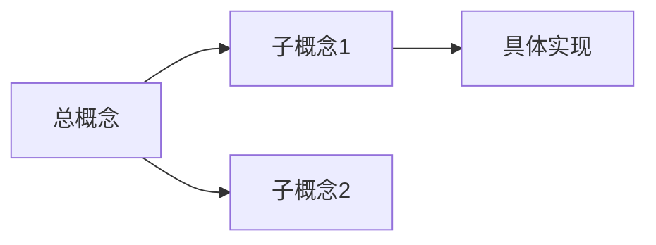

# 主题名

> 来源：第 X 期 / 课程名 / 讲师。

## 输入与目标

- **输入**（input）：这节课/这章的来源，视频、教材或实验。
- **输出**（output）：学完要产出什么——一篇笔记、一段代码、一张图、一个能跑通的实验。学完没产出，等于没学。
- 本次练的是：流体（推理能力）还是晶体（知识积累）？

## 前置知识

- 学这部分之前需要先会什么，给链接。

## 正文

按课程顺序组织，一节一个二级标题。代码配注释，原理配图。**摘录的内容必须用自己的话重写**。

### 小节标题

内容。

## 心理表征（结构图）

把本章的知识点画成结构，理清它们之间的关系。

## 小结

本节核心结论，三五行以内。

## 自测

- Q：
- A：

## 待办（大 / 中 / 小）

行动力大中小原则：用小事启动，降低启动阻力。

- **大**（方向性任务，需要整块时间）：
- **中**（一两个小时能完成的）：
- **小**（五分钟内能开始的）：

## 疑问

- [ ] 没弄懂的点，标出来日后回补，链接到相关笔记。