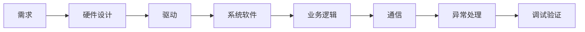
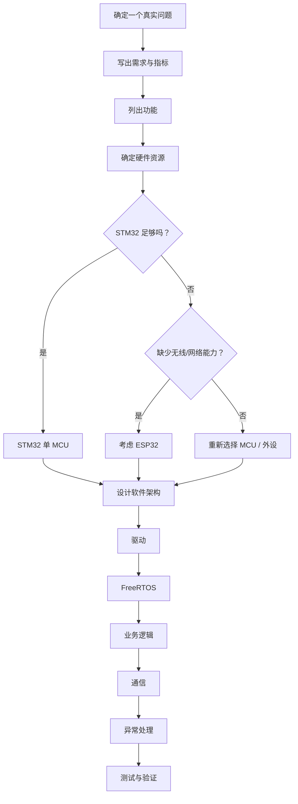

# project

[toc]








### demo

一个小型智能设备控制器

```
设备启动
 ↓
自检
 ↓
加载配置
 ↓
等待用户
 ↓
工作
 ↓
异常？
 ├── 否 → 正常运行
 └── 是
       ↓
     故障处理
       ↓
     恢复 / 安全状态
```

然后加入：

- 按键
- LCD
- 传感器
- 电机/舵机
- 蜂鸣器
- LED
- Flash 参数
- UART
- RS485/CAN（如果你后面愿意买）
- FreeRTOS

**这些东西不是为了“炫技术”。**

每一个都应该有理由。


需求 → 指标 → 芯片选择 → 外设选择 → 硬件架构 → 软件架构 → FreeRTOS 任务划分 → 驱动 → 通信协议 → 异常处理 → 测试 → 最终应该达到什么程度。


### 检验

一个项目做到下面这些，你就可以认为**这个项目基本完成了**：

#### 硬件

- 能自己看原理图
- 能判断供电
- 能配置 GPIO
- 能使用 UART/SPI/I2C
- 能处理按键/中断
- 能处理基本硬件异常

#### 软件

- 有 BSP
- 有 Driver
- 有 Application
- 有明确的状态
- Task 职责明确
- IPC 合理 （inter-process communication）
- 错误处理存在

#### RTOS

能够解释：

> 为什么这里是 Task？

> 为什么这里用 EventGroup？

> 为什么这里不能在 ISR 里干？

> 为什么这个 Task priority 是这个值？

> 这个 Task 阻塞在哪里？

#### 调试

能够处理：

```
编译错误
 ↓
运行错误
 ↓
逻辑错误
 ↓
死锁
 ↓
Task 卡死
 ↓
栈溢出
 ↓
Watchdog
 ↓
内存问题
```


### semaphore

> 因为system status是共享变量，所以需要加锁


