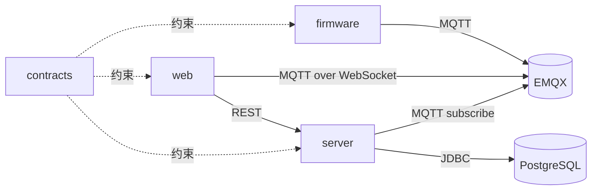

# 软件工程规范方案

> 本方案定义“项目怎么组织、版本怎么确定、代码怎么提交、前后端与硬件怎么联系”。
> 执行状态：工程化基线已完成并合入 `main`；固件编码规范正在落地到代码，产品仓库位于 `D:\git\projects\agri-iot`，旧目录保留，生产尚未切换。

## 0. 执行状态

截至 2026-10-31：

| 项目 | 结果 |
| --- | --- |
| 产品仓库 | `D:\git\projects\agri-iot` |
| 基线提交 | `5cea38a` |
| 当前提交 | `257ded7`，工程化整理、部署卫生与端到端冒烟脚本已合入 `main` |
| 工作区 | 固件规范落地、文档与主机测试改动尚未提交 |
| 历史导入 | 固件、后端、前端、部署均用 `git subtree` 导入 |
| 固件来源 | `D:\git\IntelligentAgri-System-ai`，`ai`，`5814d09` |
| 平台来源 | `D:\code\javawebP`，`main`，`325cee7` |
| 旧目录 | 未删除、未移动；生产仍使用旧路径 |
| 文档 | 架构、契约、构建、部署、版本、测试、决策已落地 |
| 契约 | MQTT JSON Schema、OpenAPI 3.1、有效/无效样例、无依赖校验器 |
| 固件验证 | 构建通过；ELF 1,162,588 字节，SHA256 `AA7FB56E900D98E677A06A0BC51718BB5EC1F1FF95905C1CE2DBD439957F0A2D`；主机侧调度器测试通过；未烧录 |
| 固件规范 | `scheduler_*`、`led_*`、`key_*` 命名与 `GATEWAY_*` 头文件保护已落地；应用层通过 `bsp_time_ms()` 获取时基 |
| 后端验证 | 15 个测试通过，`mvn package` 通过 |
| 前端验证 | `npm ci` 325 包；生产依赖 0 漏洞，开发依赖 8 个 moderate（eslint 链）；lint、build 通过 |
| 契约验证 | `node tests/contract/validate.mjs`，11 个样例通过 |
| 工具与 CI | 构建、校验、密钥扫描脚本与 GitHub Actions 已建立 |
| 端到端 | `tests/e2e/smoke.mjs` 覆盖状态、遥测、bootstrap 与回执落库；容器联调受本机镜像源阻塞 |
| 部署脚本 | 已支持备份、恢复、健康检查、镜像回滚与首次接管保护；未在生产执行 |
| 下一步 | 统一 `gw_status_t` 错误码；补 JSON/主题拼接主机测试；真实配置烧录与 H1–H9 硬件验收；预发布部署与回滚演练；EMQX 认证/ACL/TLS 整改；生产切换 |

实际落地与后文计划命名的差异：文档采用 `00-工程规范`、`10-系统架构`、`20-接口契约`、`30-构建与烧录`、`40-部署与运维`、`50-版本与发布`、`60-测试与验证`、`90-历史决策`；HTTP 契约使用 `contracts/http/openapi.json`；部署与备份脚本位于 `deploy/` 根目录。后续维护以产品仓库实际结构为准。

## 1. 目标与边界

目标：

- 一个产品只有一个产品版本和一套发布清单。
- 固件、后端、前端、部署和文档能在同一仓库中对应到同一个版本。
- 任何人或 AI 不依赖聊天记录，也能判断当前运行的是哪一版。
- 文档、代码、版本、Git、环境和操作流程有固定入口。

边界：

- `D:\git\embedded` 是知识库，不是产品代码仓库。
- 本方案不把课程笔记、AI 会话记录和产品代码混在一起。
- 本方案不先改业务代码；先确定目录、契约和流程。

## 2. 软件工程阶段与产物

| 阶段 | 主要产物 | 存放位置 |
| --- | --- | --- |
| 立项 | 项目章程、范围、角色、验收目标 | `docs/00-项目章程.md`、`docs/01-需求与范围.md` |
| 设计 | 架构、接口契约、关键决策 | `docs/02-架构.md`、`contracts/`、`docs/adr/` |
| 实现 | 固件、后端、前端、部署脚本 | `firmware/`、`server/`、`web/`、`deploy/` |
| 验证 | 单元、集成、契约、硬件在环 | 各组件 `tests/`、`tests/contract/`、`tests/hil/` |
| 发布 | 版本号、变更记录、发布清单 | `VERSION`、`CHANGELOG.md`、`release-manifest.json` |
| 运维 | 操作、排障、回滚、版本核对 | `docs/09-操作手册.md`、`docs/10-版本清单.md` |

## 3. 工作区规划

执行原则：

- 本方案不删除 `D:\git` 下的任何现有目录。
- 目标结构是推荐布局，不是立即搬迁；先备份、建新仓库并验证可用，再处理旧目录。
- 未纳入本产品的目录保持原位；需要整理时先做清单，确认后再移动。
- 旧仓库只归档、不删除；确认新仓库能构建、能烧录、能部署后才停用旧副本。

目标结构：

```text
D:\git\
├─ embedded\                 # 保留：个人知识库，不放产品代码
├─ AI\                       # 保留：AI 会话与知识库
├─ obsidian\                 # 保留：Obsidian 相关
├─ projects\
│  ├─ agri-iot\              # 智慧农业产品
│  └─ <其他产品>\
├─ labs\                     # 实验代码：arduino、stm32P、ESP32P、demo
├─ third-party\              # 第三方克隆：FreeRTOS-Kernel 等
└─ archive\                  # 旧项目、zip、废弃版本
```

目录职责：

| 目录 | 职责 | 是否进入产品发布 |
| --- | --- | --- |
| `embedded` | 课程、项目笔记、复盘、MOC | 否 |
| `AI` | AI 会话记忆与知识条目 | 否 |
| `projects/agri-iot` | 智慧农业产品源码与文档 | 是 |
| `projects/<其他产品>` | 其他独立产品 | 各自发布 |
| `labs` | 实验、验证、临时工程 | 否 |
| `third-party` | 上游代码，不修改上游历史 | 否 |
| `archive` | 只读归档 | 否 |

当前目录的问题：

- `D:\git` 同时放了知识库、第三方代码、产品、实验和重复工作区，角色不清。
- `IntelligentAgri-System` 与 `IntelligentAgri-System-ai` 是同一仓库的重复工作区，容易出现两份不同状态。
- `D:\code\javawebP` 是平台代码，但名称不能表达产品边界，且与固件仓库分离。
- 固件、后端、前端没有统一的产品版本，接口变更容易只改一端。

## 4. 产品仓库规划

推荐采用产品 monorepo：

```text
agri-iot\
├─ README.md
├─ VERSION
├─ CHANGELOG.md
├─ release-manifest.json
├─ docs\
│  ├─ README.md
│  ├─ 00-项目章程.md
│  ├─ 01-需求与范围.md
│  ├─ 02-架构.md
│  ├─ 03-接口契约.md
│  ├─ 04-环境与构建.md
│  ├─ 05-代码规范.md
│  ├─ 06-测试与验收.md
│  ├─ 07-部署与运维.md
│  ├─ 08-版本与发布.md
│  ├─ 09-操作手册.md
│  ├─ 10-版本清单.md
│  └─ adr\
├─ contracts\
│  ├─ mqtt\
│  │  ├─ telemetry.schema.json
│  │  ├─ status.schema.json
│  │  ├─ command.schema.json
│  │  └─ ack.schema.json
│  └─ http\
│     └─ openapi.yaml
├─ firmware\
│  ├─ gateway\
│  ├─ node\
│  ├─ shared\
│  └─ tests\
├─ server\
├─ web\
├─ deploy\
│  ├─ compose\
│  ├─ nginx\
│  ├─ scripts\
│  └─ env\
├─ tools\
└─ tests\
   ├─ contract\
   ├─ e2e\
   └─ hil\
```

### 4.1 单仓库与多仓库的取舍

| 方案 | 优点 | 风险 | 适用 |
| --- | --- | --- | --- |
| 产品 monorepo | 契约变更可一次提交；产品版本统一；CI 一次构建全部 | 仓库变大；需要目录边界 | 单人维护的完整产品 |
| 多仓库 + 契约仓库 | 组件独立发布 | 版本漂移；跨仓库改动难同步 | 多团队、独立交付 |

本项目的推荐：**产品 monorepo**。固件、后端、前端是同一产品的组件，不是三个独立产品。

## 5. 文档规范

文档原则：

- `README.md` 只做 5 分钟入口。
- `docs/README.md` 是唯一文档索引。
- 一份文档只回答一个问题，重复内容合并，过期内容删除。
- 代码和文档在同一个提交中更新。
- 关键决策写 ADR，不散落在聊天记录里。
- 版本判断只看 `docs/10-版本清单.md`。

文档清单：

| 文档 | 回答的问题 |
| --- | --- |
| `00-项目章程.md` | 为什么做、做到什么程度 |
| `01-需求与范围.md` | 做什么、不做什么、验收标准 |
| `02-架构.md` | 组件边界、数据流、部署结构 |
| `03-接口契约.md` | MQTT/REST 的主题、字段、错误码 |
| `04-环境与构建.md` | 工具链、依赖、环境变量、构建命令 |
| `05-代码规范.md` | 命名、注释、错误处理、格式化 |
| `06-测试与验收.md` | 单测、集成、契约、HIL、验收 |
| `07-部署与运维.md` | 部署、监控、备份、回滚 |
| `08-版本与发布.md` | SemVer、标签、产物、发布清单 |
| `09-操作手册.md` | 人可以直接照做的命令 |
| `10-版本清单.md` | 当前固件、镜像、数据库版本 |
| `adr/NNNN-*.md` | 为什么做某个技术选择 |

## 6. 版本规范

产品版本采用 SemVer：

```text
v0.3.0
├─ firmware 0.3.0 + git sha
├─ api      0.3.0 + git sha
├─ web      0.3.0 + git sha
├─ db       Flyway V3
└─ mqtt     contract v1
```

规则：

- 产品打 `vMAJOR.MINOR.PATCH` annotated tag。
- 破坏接口契约升 major；新增功能升 minor；修复升 patch。
- 固件、后端、前端产物都带版本与 commit。
- 固件 ELF、API 镜像 digest、Web 构建包写入 `release-manifest.json`。
- 不使用“final、new、最新版”作为版本名；日期只放构建元数据。
- 数据库结构只通过 Flyway 迁移，生产不手工改表。

## 7. Git 规范

| 项目 | 规则 |
| --- | --- |
| 主分支 | `main` 始终可运行、可部署 |
| 功能分支 | `feat/<scope>-<主题>` |
| 修复分支 | `fix/<scope>-<主题>` |
| 文档分支 | `docs/<主题>` |
| 提交格式 | Conventional Commits |
| 合并 | 一个功能一个 PR；小改动可直接提交 `main` |
| 发布 | annotated tag；必要时开 `release/x.y` |
| 工作区 | 一个仓库一个主工作区，其他用分支，不保留重复目录 |

提交示例：

```text
feat(firmware): 增加 set_led1 指令别名
fix(server): 60 秒未上报判定离线
docs(contract): 补充 command schema
```

禁止：

- 提交 `.env`、密码、token、ELF、jar、`node_modules`、日志。
- 在生产目录直接改文件。
- 用两个目录同时代表同一仓库。

## 8. 代码规范

### 8.1 命名

| 范围 | 规则 | 示例 |
| --- | --- | --- |
| C 文件 | `snake_case.c/.h` | `mqtt_app.c` |
| C 类型 | `PascalCase_t` | `MqttMessage_t` |
| C 公共函数 | `module_action()` | `mqtt_app_publish()` |
| C 静态函数 | `snake_case()` | `parse_payload()` |
| C 宏 | `UPPER_SNAKE_CASE` | `GW_MQTT_PORT` |
| Java 包 | 全小写 | `com.agri.iot.server` |
| Java 类 | `PascalCase` | `TelemetryIngestService` |
| Java 方法 | `camelCase` | `handleTelemetry()` |
| Vue 组件 | `PascalCase.vue` | `DeviceCard.vue` |
| Vue store | `useXxxStore` | `useDeviceStore` |
| 分支 | 小写 kebab-case | `feat/server-stale-status` |
| 版本 | SemVer | `v0.3.0` |

### 8.2 注释

- C 模块头写用途、依赖、输入输出、约束。
- 公共函数写参数、返回值、副作用、线程/中断约束。
- 硬件代码写单位、寄存器、时序和所有权。
- 协议代码写字段映射和兼容条件。
- 不写重复代码表面行为的注释。

### 8.3 代码实现流程

1. 写清需求和验收标准。
2. 先改契约，再改实现。
3. 先写测试或至少写验证步骤。
4. 实现最小闭环，不做范围外重构。
5. 跑格式化、静态检查和测试。
6. 更新文档与版本清单。
7. 提交一个自包含的 commit。

### 8.4 完成定义

- 代码通过格式化和静态检查。
- 单元测试和相关集成测试通过。
- 契约变更已同步固件、后端、前端。
- 文档已更新。
- 版本清单已记录产物哈希或镜像 digest。
- 失败可回滚。

## 9. 环境规范

固定工具链：

| 范围 | 工具 | 版本 |
| --- | --- | --- |
| 固件 | CMake | 4.3.1 |
| 固件 | Ninja | 1.13.2 |
| 固件 | GCC | 14.3.1 |
| 固件 | OpenOCD | 0.12.0 |
| 后端 | JDK | 17 |
| 后端 | Maven | 3.9 |
| 前端 | Node.js | 24 |
| 前端 | npm | 11 |
| 基础设施 | Docker Compose | 当前服务器版本 |
| 数据库 | PostgreSQL | 16 |
| Broker | EMQX | 5.8.6 |

环境分层：

| 环境 | 用途 | 数据 |
| --- | --- | --- |
| 本地开发 | 编码、单元测试、本地 Compose | 本地测试数据 |
| 硬件实验 | 板子、ST-Link、串口、MQTTX | 测试设备 |
| 预发/测试 | 部署验证（可选） | 测试数据 |
| 生产 | 对外服务 | 生产数据 |

规则：

- 配置放 `.env.example`，真实值只放本机或服务器 `.env`。
- 开发库和生产库不自动同步；同步必须 `pg_dump`/`pg_restore` 并留备份。
- 不使用宝塔“数据库”页面管理 Docker 内的 PostgreSQL；数据库操作走脚本或 `docker exec`。
- 工具链版本写入 `docs/04-环境与构建.md` 和构建配置。

## 10. 前端、后端、硬件的关系



图 1 产品组件与契约关系

- `contracts/mqtt/*.schema.json` 是主题和 payload 的唯一事实源。
- `contracts/http/openapi.yaml` 是 REST 接口的唯一事实源。
- 固件、后端、前端都通过契约测试，不直接依赖对方代码。
- 改字段必须同时改契约、固件、后端、前端、测试和文档。
- 固件不直接调用后端；Web 不直接读数据库；后端不假设设备一定在线。

## 11. 迁移步骤

1. 冻结基线：提交或备份两个仓库，打 `pre-merge` 标签，停止双工作区。
2. 新建 `projects\agri-iot`，用 `git subtree` 或 `git filter-repo` 保留固件和平台历史。
3. 重组目录：固件进 `firmware/gateway`，后端进 `server`，前端进 `web`，部署进 `deploy`。
4. 抽取契约：MQTT 主题、payload、REST 接口放入 `contracts`。
5. 建文档索引、版本清单、操作手册。
6. 加最小 CI：固件构建、后端测试、前端 lint/build、契约校验。
7. 验证新仓库能构建、能烧录、能部署后，再归档旧目录。

## 12. 待确认

- 是否采用产品 monorepo。
- `D:\git\embedded` 是否保留原路径。
- 是否保留两个旧仓库的 Git 历史。
- 是否先迁移智慧农业，还是同时整理其他项目。

推荐答案：

- 采用 monorepo。
- 保留 `embedded` 原路径。
- 保留历史，用 `git subtree` 迁移。
- 先迁移智慧农业，其他项目按同一规则逐步整理。

## 13. 验收标准

- 任意一个发布版本能通过 `release-manifest.json` 找到固件、API、Web、数据库版本。
- 任意一个组件能通过契约找到对端字段定义。
- 任意一次部署能通过 `docs/09-操作手册.md` 复现。
- 任意一次故障能通过 `docs/10-版本清单.md` 确定当前版本。
- `embedded` 只保留笔记，不再混入产品源码。
